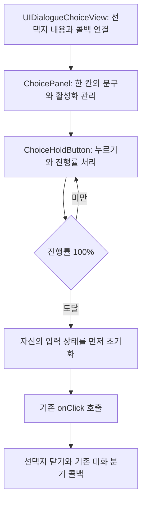
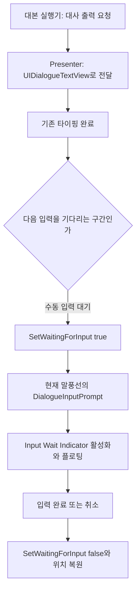

# 선택지 홀드 입력·대화 입력 대기 표시 변경 상세

작성 기준: 2026-10-16, 이 문서를 작성할 때의 작업 파일.

이번 작업은 선택지 확정 방식을 길게 누르기로 바꾸고, 선택지의 진행바·호버 상태를 관리하며, 대화가 다음 입력을 기다릴 때 표시하는 아이콘을 연결한 것이다. 이 문서는 구현 구조, 실제 변경 코드, 프리팹 데이터, 테스트, 수정 위치를 함께 기록한다. 새 C# 파일의 전체 내용과 기존 C# 파일의 변경 diff는 뒤의 부록에 수록한다.

## 1. 변경 범위와 변경 주체

### 1.1 C# 파일 11개

| 구분 | 파일 | 역할 |
|---|---|---|
| 신규 런타임 | `ChoiceHoldButton.cs` | Button 상속, 홀드 확정·감소·재개·호버·입력 취소 |
| 신규 런타임 | `DialogueInputPrompt.cs` | 대화 입력 대기 아이콘 표시와 위아래 움직임 |
| 신규 에디터 | `ChoiceHoldButtonEditor.cs` | 기본 Button Inspector와 홀드 설정을 함께 표시 |
| 수정 | `UIDialogueTextView.cs` | 현재 말풍선으로 입력 대기 상태 전달, 타이핑 중단 시 표시 해제 |
| 수정 | `IDialoguePresenter.cs` | 별도 선택적 인터페이스 `IDialogueInputPrompt` 추가 |
| 수정 | `BarStoryPresenter.cs` | 바 실행기와 공용 대화 UI 사이에서 대기 상태 전달 |
| 수정 | `OutsideDialoguePresenter.cs` | 실외 실행기와 공용 대화 UI 사이에서 대기 상태 전달 |
| 수정 | `StoryScriptRunner.cs` | 바 대본의 다음 입력 대기 구간에서 표시를 켜고 끔 |
| 수정 | `DialogueRunner.cs` | 실외 대사의 수동 입력 대기 구간에서 표시를 켜고 끔 |
| 신규 테스트 | `ChoiceHoldButtonTests.cs` | 선택지 입력·복원·프리팹 설정 검사 21개 |
| 신규 테스트 | `DialogueInputPromptTests.cs` | 대기 모션·초기화·프리팹 연결 검사 3개 |

신규 C# 5개에는 각각 Unity `.meta` 파일도 추가했다. GUID는 부록에 원문과 함께 기록한다.

### 1.2 프리팹 4개

| 프리팹 | 이번 기능을 위해 변경한 내용 |
|---|---|
| `ChoicePanel.prefab` | Button을 ChoiceHoldButton으로 교체, 진행바 계층·연결·시간 설정 추가, 편집용 기본 외형 저장 |
| `outside ChoicePanel.prefab` | 같은 홀드 기능과 진행바 추가, 편집용 기본 외형 저장 |
| `Dialogue TextBox.prefab` | DialogueInputPrompt 컴포넌트와 Input Wait Indicator 자식 추가 |
| `OutsideDialogue TextBox.prefab` | 같은 대기 표시를 실외 대화창 크기에 맞춰 추가 |

선택지의 배경 A/B 이미지 연결, 이미지 임포트 방식, 진행바의 최종 좌표·여백·색에는 사용자가 Unity에서 조정한 값도 포함되어 있다. 따라서 이 문서의 프리팹 수치는 **현재 저장된 값**이다. 모든 디자인 값을 코드에서 자동 산출하거나 전부 내가 최초 지정했다는 의미는 아니다.

`Play.unity`, 선택지 이미지들의 `.png.meta`, Addressable 설정 등에 있는 작업 변경도 별도로 존재한다. 이번 입력 처리와 대기 모션을 구현하면서 해당 씬·Addressable 파일을 직접 수정하지 않았다. 씬의 프리팹 인스턴스는 연결된 프리팹의 컴포넌트와 새 자식을 상속한다.

### 1.3 그대로 사용하는 기존 코드

`ChoicePanel.cs`, `UIDialogueChoiceView.cs`, `DynamicSpeechbubble.cs`, `DialogueTypingService.cs`, `DialogueTextPlayer.cs`의 구현은 이번 작업에서 수정하지 않았다. 선택지 문구 설정, 페이지 처리, 대화 타이핑, 말풍선 크기 계산은 기존 구조를 사용한다.

## 2. 전체 실행 구조

선택지 흐름:



대화 대기 표시 흐름:



선택지의 홀드는 선택지를 확정하는 규칙이다. 대화창의 입력 대기 아이콘은 기존 다음 입력 대기를 시각적으로 표현한다. 대사를 넘기는 클릭에 1초 홀드 규칙을 적용한 것은 아니다.

## 3. ChoiceHoldButton의 설계

### 3.1 Button을 상속한 이유

`public sealed class ChoiceHoldButton : Button`으로 구현했다. 기존 `ChoicePanel`은 버튼 필드를 `Button` 타입으로 보관하고, `UIDialogueChoiceView`는 `GetButton().onClick.AddListener(...)`로 결과 콜백을 등록한다. 하위 타입을 사용하면 이 연결을 유지하면서 UI 입력 이벤트의 처리 방식을 바꿀 수 있다.

따라서 기존 선택지 표시 코드에 홀드 타이머나 진행바 코드를 넣지 않았다. 진행률이 100%에 도달하면 새 버튼이 기존 `onClick`을 호출한다.

### 3.2 Inspector 설정

| 필드 | 기본값 | 의미 |
|---|---:|---|
| `holdDuration` | 1초 | 진행률 0에서 1까지 채우는 데 필요한 시간 |
| `resetDuration` | 0.2초 | 진행률 1에서 0까지 감소하는 데 필요한 시간 |
| `holdProgressRoot` | 프리팹 참조 | 배경과 채움 이미지를 포함하는 진행바 오브젝트 |
| `holdProgressFill` | 프리팹 참조 | 가로 너비를 변경하는 채움 Image |

Inspector의 `[Min]` 속성에 더해 계산할 때도 `Mathf.Max`를 사용한다. 홀드 시간은 계산상 최소 0.1초, 감소 시간은 최소 0.01초로 취급한다.

### 3.3 런타임 상태 필드

| 필드 | 의미 |
|---|---|
| `holding` | 현재 진행률을 증가시키는 입력이 유지되는지 |
| `heldPointerId` | 홀드를 시작한 포인터의 ID |
| `holdStartedAt` | 이번 누르기를 시작한 시각 |
| `holdStartProgress` | 이번 누르기 시작 순간 남아 있던 진행률 |
| `lastProgressUpdateTime` | 감소량 계산에 사용할 직전 갱신 시각 |
| `displayedProgress` | 화면에 표시 중인 0~1 진행률 |
| `pointerInside` | 커서가 버튼 안에 있는지에 대한 외형 처리용 상태 |
| `hoverPointer` | 입력 모듈의 현재 hovered 목록을 확인할 PointerEventData |
| `submitControl` | 키보드·패드에서 홀드를 시작한 실제 ButtonControl |

이 상태들은 직렬화하지 않는다. 프리팹에는 외형 참조와 시간 설정만 저장하고, 입력 중간 상태는 실행 중에 관리한다.

### 3.4 마우스 누르기 시작

`OnPointerDown()`은 기본 Button의 선택·외형 처리를 수행한 다음, 왼쪽 버튼이고 이미 홀드 중이 아니며 `IsActive() && IsInteractable()`일 때 홀드를 시작한다. 이때 포인터 ID를 기록한다.

`BeginHold()`는 현재 진행률을 `holdStartProgress`에 저장하고 시작 시각을 기록하며 진행바를 켠다. 진행률을 0으로 지우지 않는 것이 감소 도중 다시 누르기 동작의 핵심이다.

### 3.5 채움 계산과 확정 시점

사용하는 식은 다음과 같다.

```text
진행률 = Clamp01(누르기 시작 시 남아 있던 진행률 + 경과 시간 / holdDuration)
```

예를 들어 현재 60%가 남아 있고 holdDuration이 1초이면, 다시 누른 후 0.4초가 더 지나면 선택된다. 재개할 때 다시 1초를 전부 기다리는 규칙은 아니다.

`Update()`에서 진행률이 1보다 작으면 표시만 갱신한다. 1에 도달하면 `CancelHold(true)`로 입력과 진행바를 먼저 초기화하고 `onClick.Invoke()`를 호출한다. 콜백이 다음 페이지를 열면서 같은 버튼을 다시 활성화해도 이전 누르기가 다시 확정되지 않도록 호출 순서를 정했다.

### 3.6 짧은 클릭이 바로 선택되지 않는 이유

`OnPointerClick()`의 구현을 비워 두었다. 기본 Button의 클릭 확정 경로가 실행되면 홀드 규칙을 우회하므로, 포인터 클릭 이벤트에서는 선택 결과를 내지 않는다. 확정은 진행률을 검사하는 `Update()`에서 한다.

외부 코드가 직접 `button.onClick.Invoke()`를 호출하면 UnityEvent는 그대로 실행된다. 기존 API와 테스트용 직접 호출은 유지된다. 홀드 제약은 이 컴포넌트를 통해 들어오는 UI 입력에 적용된다.

### 3.7 감소 계산

입력이 끝나면 `holding = false`로 바꾸되 진행률은 유지한다. 이후 Update에서 다음 식으로 감소시킨다.

```text
감소 속도 = 1 / resetDuration
다음 진행률 = MoveTowards(현재 진행률, 0, 감소 속도 × 이번 프레임 경과 시간)
```

기본 설정은 채움 속도 1/초, 감소 속도 5/초다. 80%가 남으면 완전히 사라지는 데 약 0.16초가 걸린다. 20%가 남으면 약 0.04초가 걸린다. 모든 잔량에 고정 0.2초를 쓰는 방식이 아니라 일정한 속도로 감소시킨다.

감소는 `MoveTowards`를 사용한 선형 변화다. 프레임마다 부드럽게 줄지만, 별도의 가감속 곡선이나 Tween easing은 추가하지 않았다.

### 3.8 감소 중 다시 누르기

예시는 다음과 같다.

| 시점 | 진행률 |
|---|---:|
| 0.8초 누름 | 80% |
| 손을 떼고 0.04초 경과 | 60% |
| 다시 누름 | 60%에서 증가 시작 |
| 추가 0.04초 누름 | 약 64% |
| 추가 누르기 총 0.4초 | 약 100%, 확정 |

`BeginHold()`가 `displayedProgress`를 출발점으로 사용하기 때문에 구현된다.

### 3.9 상황별 취소 규칙

| 상황 | 처리 |
|---|---|
| 누르던 왼쪽 포인터를 놓음 | 현재 값부터 부드럽게 감소 |
| 누르던 포인터가 버튼 밖으로 나감 | 현재 값부터 감소 |
| 다른 버튼으로 선택 포커스가 이동함 | 현재 값부터 감소 |
| 키보드·패드의 Submit 버튼을 놓음 | 현재 값부터 감소 |
| 버튼/상위 오브젝트 비활성화 | 즉시 0으로 초기화 |
| 홀드 중 버튼이 비활성 조건이 됨 | 즉시 초기화 |
| 게임 창 포커스 상실/애플리케이션 일시 정지 | 홀드와 기본 Button 표시 상태를 함께 초기화 |
| 선택 확정 | 콜백을 호출하기 전에 즉시 초기화 |
| 실행 중 다시 활성화 | 이전 진행률을 즉시 초기화 |
| 포인터를 누르지 않고 버튼 안으로 재진입 | 새 홀드를 시작하지 않음 |

다른 포인터의 Up 이벤트는 홀드를 취소하지 않도록 `heldPointerId`를 비교한다. 우클릭으로 홀드를 시작하지 않는다.

### 3.10 시간 기준

홀드, 감소, 재개 계산은 `Time.unscaledTimeAsDouble`을 사용한다. `Time.timeScale`이 바뀌어도 UI 입력 시간의 속도를 유지한다. 게임 창 포커스 상실과 애플리케이션 pause는 별도 이벤트에서 초기화한다.

### 3.11 진행바 너비 표현

`SetProgress()`는 `Image.fillAmount` 대신 채움 RectTransform의 앵커를 변경한다.

```csharp
rect.anchorMax = new Vector2(progress, 1f);
```

채움의 기본 anchorMin은 (0,0), sizeDelta와 오프셋은 0이다. 따라서 가로 너비가 부모 진행바 너비 × 진행률로 바뀐다. 세로 방향은 부모를 채운다. 단색 사각형 Image를 그대로 사용할 수 있고 런타임에서 별도의 텍스처를 만들지 않는다.

진행바의 위치·높이·색은 프리팹에서 정한다. 이 메서드는 `anchorMax.x`와 `anchorMax.y = 1`을 갱신하므로, 진행바 전체 배치는 부모 `Hold Progress`에서 조절하는 것이 맞다.

## 4. 선택지 호버 관련 수정 3가지

### 4.1 마우스를 놓을 때 호버가 사라지던 문제

기본 Selectable은 Selected 상태를 Highlighted보다 먼저 판단한다. 마우스로 클릭한 버튼은 선택 포커스를 유지하므로, 손을 떼면 Selected 상태가 되고 Selected Sprite가 비어 있으면 일반 이미지로 보일 수 있었다.

`DoStateTransition()`에서 상태가 Selected이고 커서가 안에 있을 때 표시 상태만 Highlighted로 바꾼다. EventSystem의 실제 선택은 유지하므로 기존 키보드·패드 탐색을 위해 선택 포커스를 강제로 지우지 않는다. Pressed와 Disabled 상태는 이 변환 조건에 포함하지 않는다.

### 4.2 같은 위치에 다음 선택지가 뜰 때 호버가 사라지던 문제

같은 슬롯을 껐다가 즉시 다시 켜면 Button의 내부 호버 상태는 지워진다. 입력 모듈은 커서 아래 대상이 같은 오브젝트이면 PointerEnter를 다시 보내지 않을 수 있다.

`OnPointerEnter()`에서 PointerEventData를 보관하고, `OnEnable()`에서 `RestorePointerHover()`를 호출하도록 했다. 복원할 때는 보관된 이벤트의 `hovered` 목록에 이 버튼이 아직 있는지 확인하고, 있으면 기본 Button의 `OnPointerEnter()`를 다시 적용한다. 목록에서 이미 빠졌으면 복원하지 않는다.

`OnPointerExit()`에서는 해당 이벤트 참조를 해제한다. 따라서 오래된 호버를 무조건 재적용하는 방식은 아니다.

### 4.3 창 전환 후 눌린 이미지가 남는 문제

초기 구현은 포커스를 잃을 때 진행바만 지웠다. 기본 Selectable이 정리하는 눌림·호버 상태까지 함께 지우도록 `ClearInputState()`를 추가했다.

`OnApplicationFocus(false)`와 `OnApplicationPause(true)`는 이 메서드를 부른다. 홀드/진행률을 초기화하고 `pointerInside = false`, `InstantClearState()`를 적용한다. 포커스 복귀 또는 pause 해제 시에는 현재 hovered 목록에 근거해 호버를 복원한다.

## 5. 선택지 프리팹과 Inspector

### 5.1 계층

```text
ChoicePanel / outside ChoicePanel
├─ Image                      일반 배경 리소스
├─ ChoiceHoldButton           기존 Button 자리에 연결
├─ ChoicePanel                기존 문구·참조 관리 컴포넌트
├─ Text (Legacy)              실제 런타임 선택지 문구
├─ Text (TMP)                 현재 비활성화된 기존 라벨
└─ Hold Progress              진행바 배경 Image
   └─ Blue Fill               진행률에 따라 너비가 바뀌는 Image
```

위 구조에서 Image·ChoiceHoldButton·ChoicePanel은 같은 루트에 있는 컴포넌트다. Text와 Hold Progress는 자식 GameObject다.

Button 교체 시 기존 버튼 컴포넌트의 fileID를 유지했다. 새 클래스가 Button의 하위 타입이므로 `ChoicePanel.button`, 씬 참조, 기존 `onClick` 연결을 유지할 수 있다. 루트 Image가 `targetGraphic`으로 연결된다.

### 5.2 현재 저장된 디자인 값

| 항목 | 바 선택지 | 실외 선택지 |
|---|---|---|
| 루트 크기 | 450 × 25 | 138.1282 × 18.2902 |
| Hold Progress 앵커 | 하단 가로 Stretch | 하단 가로 Stretch |
| Hold Progress 위치 | (0, 4.82) | (0.5, 3.51) |
| Hold Progress sizeDelta | (-60, 2) | (-19, 1) |
| 진행바 배경 RGBA | (0.03, 0.07, 0.12, 0.85) | 같음 |
| Blue Fill RGBA | (0.1, 0.85882354, 1, 1) | (0.10196078, 0.857542, 1, 1) |
| holdDuration / resetDuration | 1 / 0.2 | 1 / 0.2 |

이 좌표·색에는 사용자가 후속으로 조정한 값이 포함된다. 런타임 코드가 위 숫자를 매 프레임 강제로 대입하지 않는다.

진행바 배경과 채움 Image의 Raycast Target은 껐다. 진행바가 버튼의 포인터 입력을 가로채지 않게 한 것이다.

### 5.3 편집 화면의 기본 모형

프리팹에서 바로 모양을 볼 수 있도록 루트를 활성화하고 너비를 실제 사용 크기 기준으로 저장했다. 문구는 `선택지 예시`, 진행바는 활성화·100% 상태로 저장했다. 실외 프리팹에서 사용하지 않는 TMP 라벨이 겹치지 않게 비활성화했다.

게임 인스턴스의 `OnEnable()`은 진행률을 0으로 만들고 진행바를 숨긴다. `Application.IsPlaying(gameObject)`를 확인하므로 편집용 기본 외형을 열었을 때는 저장한 모형을 유지한다. 실제 문구는 기존 `ChoicePanel.SetPanelText()`로 교체된다.

### 5.4 이미지 크기와 리소스 연결

현재 두 선택지 모두 Source Image가 `IMG_choice_A`, Highlighted/Pressed Sprite가 `IMG_choice_B`다. 이 연결은 후속 Unity 편집을 반영한 현재 상태다. Selected/Disabled Sprite는 현재 비어 있다. 키보드 선택 외형이나 잠긴 선택지 전용 외형을 따로 쓰려면 해당 필드에 리소스를 지정할 수 있다.

A/B PNG의 원본은 모두 2103 × 228이지만, 이전 자동 슬라이스 영역은 A 2030 × 158, B 2084 × 212로 달랐다. B의 발광 영역 때문에 각 스프라이트를 같은 버튼 사각형에 맞추면 내부 테두리가 달라 보일 수 있었다. 같은 원본 영역을 사용하는 Single 설정과 A/B 재연결을 안내했고, 현재 해당 이미지 메타에는 Single 설정이 저장되어 있다.

Sprite Swap은 이미지 교체이고 RectTransform 크기 자동 보정 기능은 아니다. 리소스의 캔버스/투명 여백을 맞추고 버튼 크기는 프리팹에서 정한다. 씬 인스턴스에 별도로 저장된 크기·스케일 override가 있으면 해당 값이 적용된다.

### 5.5 ChoiceHoldButtonEditor

기본 `ButtonEditor`를 상속하고 `base.OnInspectorGUI()`를 호출한다. 기존 Transition, Target Graphic, Sprite State, Navigation, On Click 설정을 그대로 보여 주면서 홀드 시간·감소 시간·진행바 참조를 추가로 노출한다.

`CustomEditor`로 ChoiceHoldButton에 적용하고 `CanEditMultipleObjects`로 여러 버튼을 동시에 편집할 수 있게 했다. SerializedObject/Property를 사용해 Unity 직렬화와 Inspector 편집 흐름을 따른다. 편집 모드에는 기본 모형과 실행 중 초기화의 차이를 안내하는 HelpBox를 표시한다.

## 6. DialogueInputPrompt의 설계

### 6.1 설정과 상태

| 필드 | 의미 |
|---|---|
| `indicator` | 실제 IMG_textbox_Next Image가 붙은 자식 RectTransform |
| `floatHeight` | 원래 위치에서 위로 이동하는 최대 거리, UI 로컬 단위 |
| `floatPeriod` | 올라갔다 내려오는 한 주기의 초 단위 시간 |
| `waiting` | 입력 대기 표시를 활성화한 상태인지 |
| `restingPosition` | 대기 시작 직전의 프리팹 기준 위치 |
| `startedAt` | 이번 대기 표시를 시작한 시각 |

`DisallowMultipleComponent`로 같은 GameObject에 중복 추가하지 못하게 했다.

### 6.2 SetWaiting(true)

처음 대기 상태로 진입할 때 현재 anchoredPosition을 기준 위치로 저장하고 시작 시각을 기록한다. 그다음 표시 GameObject를 켠다. 이미 대기 중일 때 true가 반복 전달되어도 기준 위치와 시작 시각을 덮어쓰지 않는다. 알림이 반복될 때마다 모션이 처음부터 돌아가거나 원점이 누적 이동하는 것을 막는다.

### 6.3 SetWaiting(false)와 생명주기

대기 중이었다면 저장한 기준 위치로 되돌리고 표시 GameObject를 끈다. OnEnable/OnDisable도 SetWaiting(false)를 호출한다. 게임에서 말풍선을 재사용하거나 숨겼다가 다시 켤 때 지난 문장의 표시 상태를 이어받지 않게 한다.

### 6.4 LateUpdate의 움직임 계산

```text
phase = 대기 시작 후 경과 시간 / floatPeriod
offset = (1 - cos(phase × 2π)) × 0.5 × floatHeight
현재 위치 = 기준 위치 + 위쪽 벡터 × offset
```

최저점과 최고점에서 움직임 속도가 자연스럽게 줄어드는 왕복 운동이다. 기준점 아래로 내려가지 않고 0에서 floatHeight만큼 위로 이동했다가 돌아온다.

기본 바 설정(floatHeight 2, floatPeriod 1.25)의 한 주기 예:

| 경과 시간 | 기준점 대비 높이 |
|---|---:|
| 0초 | 0 |
| 0.3125초 | 1 |
| 0.625초 | 2 |
| 0.9375초 | 1 |
| 1.25초 | 0 |

대기 표시 역시 unscaledTimeAsDouble을 사용한다. 투명도·크기 변화나 별도 클릭 처리는 추가하지 않았다. 위치를 갱신하는 컴포넌트이며 입력 자체는 기존 실행기가 받는다.

## 7. 대사 출력 완료와 입력 대기를 연결한 코드

### 7.1 IDialogueInputPrompt

`IDialoguePresenter.cs`에 `SetWaitingForInput(bool waiting)`을 가진 별도 인터페이스를 추가했다. 바와 실외 Presenter가 이 인터페이스를 구현한다. 실행기는 해당 인터페이스를 지원하는 표현기에 대기 상태를 전달한다. 기존 Presenter 인터페이스의 필수 메서드를 늘리지 않아 기존 테스트용 표현기와 다른 구현체를 그대로 사용할 수 있다.

### 7.2 UIDialogueTextView

`SetWaitingForInput(bool)`를 추가했다. 루나·손님·내레이션 말풍선 각각을 확인하되 `targetBubble`과 일치하는 현재 말풍선만 true를 받게 한다. 그 외 말풍선의 표시는 false로 정리한다.

`SetBubbleWaiting()`은 대상 말풍선에 DialogueInputPrompt가 연결되어 있는지 `TryGetComponent`로 확인한다. 대기 요청이 true여도 말풍선이 activeInHierarchy 상태일 때만 켠다. 해당 컴포넌트가 없는 기존 말풍선은 이 표시 요청을 생략한다.

`StopTyping()` 시작 부분에도 `SetWaitingForInput(false)`를 추가했다. 이 정리는 currentPlayer가 null인 경우에도 먼저 실행한다. 기존 ClearText, OnDisable, 새 타이핑 시작 등의 경로가 StopTyping을 사용하므로 이전 문장의 표시를 함께 정리할 수 있다.

CompleteTyping이 아이콘을 자동으로 켜도록 바꾸지는 않았다. 타이핑 완료 뒤 실제 입력 대기가 있는지는 실행기가 판단한다.

### 7.3 BarStoryPresenter

클래스 구현 목록에 IDialogueInputPrompt를 추가하고, 받은 상태를 `textView.SetWaitingForInput(waiting)`으로 전달하는 메서드를 추가했다. 기존 ShowSayAsync, 인물 연출, 선택 결과 처리의 내용은 유지했다.

### 7.4 StoryScriptRunner

`WaitForAdvanceAsync()`에서 advanceSignal을 준비하고 Presenter를 IDialogueInputPrompt로 받아 둔다. try에서 표시를 켠 뒤 기존 입력 완료 Task를 기다리고, finally에서 신호와 표시를 정리한다.

기존 SayAsync는 ShowSayAsync의 타이핑이 끝난 후 이 메서드를 호출한다. 주문 문구도 같은 대기 메서드를 사용하므로 동일하게 적용된다. 정상 입력뿐 아니라 취소 토큰으로 대기가 끝나는 경우에도 finally가 표시를 해제한다.

### 7.5 OutsideDialoguePresenter

IDialogueInputPrompt를 구현하고 `typer.SetWaitingForInput(waiting)`으로 전달한다. HideDialogue에도 false 전달을 추가해 대화 패널을 숨길 때 표시 상태를 함께 해제한다.

### 7.6 DialogueRunner

실외 SayAsync는 기존처럼 ShowDialogueAsync로 타이핑이 끝날 때까지 기다린 뒤 WaitingForInput 상태로 간다. sync가 auto이면 기존 2초 자동 대기 경로를 사용하며 입력 대기 표시를 켜지 않는다.

수동 입력 경로에서는 입력 신호를 만들고, Proximity 모드가 아닐 때 표시를 켠다. 이는 기존 AdvanceInputOutside가 Proximity 모드의 수동 진행을 받지 않는 규칙에 맞춘 것이다. 입력 완료 또는 취소 시 finally에서 표시를 끈다.

이번 표시 연결은 공용 UIDialogueTextView를 사용하는 바·실외 대화 실행 경로에 적용했다. Cutscene Studio의 별도 UI/재생기나 자동 Timeline 대사에 입력 대기 표시를 추가하는 변경은 포함하지 않았다.

## 8. 대화창 프리팹 데이터

두 프리팹 모두 루트에 DialogueInputPrompt를 추가하고, 그 아래 Input Wait Indicator 자식을 추가했다. 기존 이름·본문 라벨과 말풍선 크기 계산 컴포넌트는 그대로 사용한다.

```text
대화창 루트
├─ Image / DynamicSpeechBubble       기존 배경·말풍선 계산
├─ 이름과 본문 등 기존 자식
├─ DialogueInputPrompt               추가한 루트 컴포넌트
└─ Input Wait Indicator              추가한 자식 GameObject
   └─ Image: IMG_textbox_Next
```

| 설정 | Dialogue TextBox | OutsideDialogue TextBox |
|---|---|---|
| Anchor Min / Max | (1,0) / (1,0) | 같음 |
| Pivot | (0.5,0.5) | 같음 |
| anchoredPosition | (-13,10) | (-8,5) |
| sizeDelta | (9.3,9) | (6.2,6) |
| Image 색 | 흰색 RGBA (1,1,1,1) | 같음 |
| Image Preserve Aspect | true | true |
| Image Raycast Target | false | false |
| floatHeight | 2 | 1 |
| floatPeriod | 1.25초 | 1.25초 |

오른쪽 하단 고정 앵커이므로 DynamicSpeechBubble이 문장에 맞춰 박스 너비나 높이를 바꿔도 아이콘은 해당 박스의 오른쪽 하단을 따라간다. 아이콘은 별도의 Button이 아니며 Raycast Target을 꺼 두었다.

리소스는 기존 `IMG_textbox_Next.png`의 실제 서브 스프라이트를 연결했다. GUID는 `a008dae5074b14dbc986444146806412`, 서브 스프라이트 fileID는 `4642209824784031650`이다. 새 이미지 파일이나 다른 화살표 리소스를 만들지 않았다.

프리팹에는 편집할 때 확인할 수 있도록 자식을 활성 상태로 저장했다. 런타임 컴포넌트의 OnEnable에서 숨기고, 실제 대기 구간에서만 켠다. 위치·크기·이미지색과 움직임 설정은 이 프리팹에서 수정할 수 있다.

## 9. 테스트와 검증 범위

### 9.1 ChoiceHoldButtonTests: 21개

파라미터화한 TestCase는 실제 실행 사례별로 센 수다.

| 테스트 메서드 | 사례 수 | 확인하는 내용 |
|---|---:|---|
| ShortClickDoesNotConfirmAndClearsProgress | 1 | 짧은 클릭으로 확정하지 않고 진행바가 정리됨 |
| OneSecondConfirmsExactlyOnceAndReleaseDoesNotConfirmAgain | 1 | 홀드 완료 한 번만 확정, 손을 떼어도 추가 확정 없음 |
| ReleaseDrainsTheBarFiveTimesFasterThanItFills | 1 | 기본 감소 속도가 채움의 5배 |
| PressingDuringResetImmediatelyFillsFromTheRemainingProgress | 1 | 감소 도중 다시 누르면 잔량에서 증가 |
| ReleasingOverASelectedChoiceKeepsHoverAndLeavingRestoresItsSelectedAppearance | 2 | 두 프리팹에서 손을 뗀 뒤 호버 유지와 이탈 표시 전환 |
| LeavingChoiceCancelsAndReenteringRequiresANewPress | 1 | 이탈하면 취소, 다시 들어오기만 해서는 홀드 시작 안 함 |
| LockedChoiceCannotStartOrFinishAHold | 1 | 잠긴 선택지는 시작·확정 불가 |
| HiddenOrDeselectedChoiceDoesNotResumeAnOldHold | 1 | 숨김·선택 해제로 이전 입력을 이어 확정하지 않음 |
| OtherPointerAndRightClickCannotCompleteOrCancelTheHeldPointer | 1 | 우클릭 시작 차단, 다른 포인터 Up으로 홀드 취소 안 함 |
| ReusingAButtonForTheNextPageDoesNotCarryOverThePress | 1 | 같은 버튼 재사용 후 이전 입력이 중복 확정하지 않음 |
| ReopeningTheSameChoiceUnderAStationaryPointerKeepsHover | 2 | 입력 모듈의 실제 포인터 이동 처리 경로로 같은 위치 재표시 호버 확인, 만료된 호버는 복원 안 함 |
| FocusLossOrPauseClearsBothTheHoldAndThePressedAppearance | 2 | 포커스 상실과 pause 각각 진행바·Pressed 상태 정리 |
| SubmitRequiresHoldingTheBoundKeyboardOrGamepadControl | 2 | 바인딩된 키보드와 패드 Submit 유지·해제·잔량 재개 |
| BothPrefabsUseAOneSecondHoldAndABlueNonBlockingBottomBar | 2 | 스크립트·시간·진행바 참조·입력 통과·기본 표시 연결 |
| EditorInstancesKeepTheirDefaultShapeAndRuntimeResetHidesOnlyProgress | 2 | 편집용 기본 모형 유지, 초기화가 진행바를 숨기며 크기·색 보존 |

테스트의 시간 진행은 실제로 1초씩 대기하는 대신 시작 시각과 직전 갱신 시각만 제어하고 실제 Update를 호출한다. 호버 재사용 검사는 InputSystemUIInputModule의 포인터 이동 처리 메서드를 사용한다. Submit 검사는 실제 InputAction과 Keyboard/Gamepad 입력 장치를 구성해 버튼 상태를 전달한다.

EditMode의 EventSystem 등록과 InputSystem 설정은 테스트 안에서 구성하고 종료 시 복원한다. 프라이빗 메서드/필드 접근에는 reflection을 사용하며 제품 API를 테스트 전용으로 확장하지 않았다.

### 9.2 DialogueInputPromptTests: 3개

| 테스트 메서드 | 사례 수 | 내용 |
|---|---:|---|
| WaitingFloatsWithoutScaledTimeAndStopsWithoutPositionDrift | 1 | 초기 숨김, timeScale 0에서도 움직임 계산, 반복 true 알림의 기준점 보존, 해제·비활성화 후 위치 복원 |
| DialoguePrefabsUseTheActualNonBlockingNextSpriteAtBottomRight | 2 | 두 프리팹에 컴포넌트·오른쪽 하단 앵커·실제 Next 스프라이트·Raycast 비활성 연결 |

### 9.3 25개 통과 수치의 구성

저장소 테스트는 선택지 21개 + 대화 표시 3개 = 24개다. 여기에 별도 최소 Unity 프로젝트의 임시 `ChoicePrefabRuntimeValidation` 검사 1개를 함께 실행하여 총 25개가 통과했다.

임시 검사는 실제 Play Mode로 진입해 두 선택지 프리팹 인스턴스의 진행바가 초기화되고, 기본 크기와 원본 프리팹의 편집용 표시가 보존되며, 재활성화 후에도 진행바가 숨겨지는지 확인했다. 이 임시 검사 파일은 제품 저장소에 추가하지 않았다.

전체 프로젝트의 기존 Unity 컴파일 응답 파일을 사용하여 런타임 Assembly-CSharp와 에디터/테스트 Assembly-CSharp-Editor의 컴파일도 확인했다. 출력 DLL은 임시 경로로 분리했다.

25개 검사는 독립 최소 Unity 프로젝트에서 실행했다. 바·실외 실행기의 새 표시 전달 코드는 원본 프로젝트 컴파일과 코드 경로 검토로 확인했다. 실제 Play/Home/OutSide 씬 전체를 처음부터 끝까지 플레이한 통합 검증 결과를 뜻하지 않는다.

시각 검증은 프리팹 배경과 실제 Next 리소스, DialogueInputPrompt의 움직임으로 프레임을 렌더링했다. 미리보기의 예시 문구는 독립 렌더용 라벨이다. 원본 게임의 TMP 라벨이나 폰트 설정을 바꾸는 작업은 포함하지 않았다.

## 10. 앞으로 수정할 위치

| 원하는 변경 | 수정 위치 |
|---|---|
| 선택에 필요한 시간 | ChoiceHoldButton / Hold Duration |
| 손을 뗐을 때 줄어드는 속도 | ChoiceHoldButton / Reset Duration |
| 감소 잔량에서 이어 누르는 규칙 | ChoiceHoldButton.BeginHold / holdStartProgress |
| 선택지 일반 이미지 | 선택지 루트 Image / Source Image |
| 호버·누르는 중 이미지 | ChoiceHoldButton / Highlighted Sprite / Pressed Sprite |
| 키보드 선택·비활성 외형 | ChoiceHoldButton / Selected Sprite / Disabled Sprite |
| 진행바 위치·높이·좌우 여백 | 자식 Hold Progress / RectTransform |
| 진행바 배경색 | Hold Progress / Image.Color |
| 진행바 채움색 | Blue Fill / Image.Color |
| 대기 아이콘 위치·크기 | Input Wait Indicator / RectTransform |
| 대기 아이콘 색·리소스 | Input Wait Indicator / Image |
| 떠오르는 최대 높이 | DialogueInputPrompt / Float Height |
| 왕복 주기 | DialogueInputPrompt / Float Period |
| 아이콘 표시 시점 | StoryScriptRunner.WaitForAdvanceAsync / DialogueRunner.SayAsync |
| 현재 말풍선만 표시하는 규칙 | UIDialogueTextView.SetWaitingForInput |

선택지 두 프리팹은 같은 C# 클래스를 사용하지만 디자인 데이터는 각각 저장한다. 현재 공통 부모 프리팹과 Variant로 통합하는 변경은 하지 않았다.

키보드·패드 홀드는 InputSystemUIInputModule의 Submit 이벤트를 받은 선택된 버튼에서 작동한다. 이번 변경에는 선택지를 열 때 첫 항목을 자동 선택하는 기능을 추가하지 않았다. 다른 UI 입력 모듈을 쓰면 현재 OnSubmit의 InputSystemUIInputModule 확인 조건을 별도로 확장해야 한다.

아래 부록은 문서 생성 시점의 실제 파일 내용이다. 이후 코드를 수정하면 부록은 다시 갱신해야 한다.

## 11. 신규 C# 파일 전체 코드

### 11.1 ChoiceHoldButton.cs

[ChoiceHoldButton.cs](<C:/Users/hyeon2-400/Human-Bartender/HumanBartender/Assets/01.Game/02.Scripts/04.Features/05.Dialogue/ChoiceHoldButton.cs>)

```csharp
using UnityEngine;
using UnityEngine.EventSystems;
using UnityEngine.InputSystem.Controls;
using UnityEngine.InputSystem.UI;
using UnityEngine.UI;

/// <summary>선택지 확인 입력을 일정 시간 유지했을 때만 onClick을 한 번 호출한다.</summary>
[AddComponentMenu("UI/Choice Hold Button")]
public sealed class ChoiceHoldButton : Button
{
    [SerializeField, Min(0.1f)] private float holdDuration = 1f;
    [SerializeField, Min(0.01f)] private float resetDuration = 0.2f;
    [SerializeField] private GameObject holdProgressRoot;
    [SerializeField] private Image holdProgressFill;

    private bool holding;
    private int heldPointerId;
    private double holdStartedAt;
    private float holdStartProgress;
    private double lastProgressUpdateTime;
    private float displayedProgress;
    private bool pointerInside;
    private PointerEventData hoverPointer;
    private ButtonControl submitControl;

    protected override void OnEnable()
    {
        base.OnEnable();
        // Prefab Mode에서는 저장된 기본 외형을 유지하고, 게임 인스턴스만 초기화한다.
        if (Application.IsPlaying(gameObject)) CancelHold(true);
        RestorePointerHover();
    }

    protected override void OnDisable()
    {
        pointerInside = false;
        if (Application.IsPlaying(gameObject) || holding || displayedProgress > 0f) CancelHold(true);
        base.OnDisable();
    }

    public override void OnPointerDown(PointerEventData eventData)
    {
        if (eventData.button == PointerEventData.InputButton.Left && CanHold()) pointerInside = true;
        base.OnPointerDown(eventData);
        if (eventData.button != PointerEventData.InputButton.Left || holding || !CanHold()) return;
        heldPointerId = eventData.pointerId;
        BeginHold();
    }

    public override void OnPointerUp(PointerEventData eventData)
    {
        base.OnPointerUp(eventData);
        if (eventData.button == PointerEventData.InputButton.Left &&
            eventData.pointerId == heldPointerId && submitControl == null)
            CancelHold();
    }

    public override void OnPointerEnter(PointerEventData eventData)
    {
        hoverPointer = eventData;
        pointerInside = true;
        base.OnPointerEnter(eventData);
    }

    public override void OnPointerExit(PointerEventData eventData)
    {
        if (hoverPointer == eventData) hoverPointer = null;
        pointerInside = false;
        base.OnPointerExit(eventData);
        if (eventData.pointerId == heldPointerId && submitControl == null)
            CancelHold();
    }

    protected override void DoStateTransition(SelectionState state, bool instant)
    {
        // 마우스로 선택된 상태에서도 커서가 안에 있으면 호버 외형을 유지한다.
        // 논리적인 선택은 유지하여 키보드·게임패드 이동을 방해하지 않는다.
        if (state == SelectionState.Selected && pointerInside) state = SelectionState.Highlighted;
        base.DoStateTransition(state, instant);
    }

    // 확정은 Update에서만 한다. 손을 뗄 때 발생하는 클릭은 다음 선택지에도 전달하지 않는다.
    public override void OnPointerClick(PointerEventData eventData) { }

    public override void OnSubmit(BaseEventData eventData)
    {
        if (holding || !CanHold()) return;
        var module = eventData.currentInputModule as InputSystemUIInputModule;
        var control = module?.submit?.action?.activeControl as ButtonControl;
        if (control == null || !control.isPressed) return;
        submitControl = control;
        BeginHold();
    }

    public override void OnDeselect(BaseEventData eventData)
    {
        CancelHold();
        base.OnDeselect(eventData);
    }

    private bool CanHold() => IsActive() && IsInteractable();

    private void BeginHold()
    {
        holding = true;
        holdStartProgress = displayedProgress;
        holdStartedAt = Time.unscaledTimeAsDouble;
        lastProgressUpdateTime = holdStartedAt;
        if (holdProgressRoot != null) holdProgressRoot.SetActive(true);
    }

    private void Update()
    {
        if (!holding && displayedProgress <= 0f) return;
        double now = Time.unscaledTimeAsDouble;
        float delta = Mathf.Max(0f, (float)(now - lastProgressUpdateTime));
        lastProgressUpdateTime = now;
        float resetSpeed = 1f / Mathf.Max(0.01f, resetDuration);
        if (!holding)
        {
            SetProgress(Mathf.MoveTowards(displayedProgress, 0f, resetSpeed * delta));
            if (displayedProgress <= 0f && holdProgressRoot != null) holdProgressRoot.SetActive(false);
            return;
        }
        if (!CanHold())
        {
            CancelHold(true);
            return;
        }
        if (submitControl != null && !submitControl.isPressed)
        {
            CancelHold();
            return;
        }

        float progress = Mathf.Clamp01(holdStartProgress + (float)((now - holdStartedAt) /
            Mathf.Max(0.1f, holdDuration)));
        SetProgress(progress);
        if (progress < 1f) return;

        // 콜백이 페이지를 바꾸거나 같은 버튼을 다시 켜도 입력은 여기서 끝낸다.
        CancelHold(true);
        onClick.Invoke();
    }

    private void CancelHold(bool immediately = false)
    {
        holding = false;
        submitControl = null;
        lastProgressUpdateTime = Time.unscaledTimeAsDouble;
        if (immediately || displayedProgress <= 0f)
        {
            SetProgress(0f);
            if (holdProgressRoot != null) holdProgressRoot.SetActive(false);
        }
    }

    private void SetProgress(float progress)
    {
        displayedProgress = progress;
        if (holdProgressFill == null) return;
        var rect = holdProgressFill.rectTransform;
        rect.anchorMax = new Vector2(progress, 1f);
    }

    private void OnApplicationFocus(bool focused)
    {
        if (!focused) ClearInputState();
        else RestorePointerHover();
    }

    private void OnApplicationPause(bool paused)
    {
        if (paused) ClearInputState();
        else RestorePointerHover();
    }

    private void RestorePointerHover()
    {
        // 같은 슬롯을 즉시 다시 켜면 입력 모듈은 PointerEnter를 재전송하지 않는다.
        // 모듈이 유지하는 실제 hovered 목록으로 기본 Button의 상태도 복원한다.
        if (!IsActive() || hoverPointer == null || !hoverPointer.hovered.Contains(gameObject)) return;
        pointerInside = true;
        base.OnPointerEnter(hoverPointer);
    }

    private void ClearInputState()
    {
        if (Application.IsPlaying(gameObject) || holding || displayedProgress > 0f) CancelHold(true);
        pointerInside = false;
        InstantClearState();
    }
}
```

### 11.2 DialogueInputPrompt.cs

[DialogueInputPrompt.cs](<C:/Users/hyeon2-400/Human-Bartender/HumanBartender/Assets/01.Game/02.Scripts/04.Features/05.Dialogue/DialogueInputPrompt.cs>)

```csharp
using UnityEngine;

/// <summary>다음 대사 입력을 기다릴 때만 프리팹의 표시를 천천히 위아래로 띄운다.</summary>
[DisallowMultipleComponent]
public sealed class DialogueInputPrompt : MonoBehaviour
{
    [SerializeField] private RectTransform indicator;
    [SerializeField, Min(0f)] private float floatHeight = 2f;
    [SerializeField, Min(0.1f)] private float floatPeriod = 1.25f;

    private bool waiting;
    private Vector2 restingPosition;
    private double startedAt;

    private void OnEnable() => SetWaiting(false);
    private void OnDisable() => SetWaiting(false);

    public void SetWaiting(bool value)
    {
        if (indicator == null) return;
        if (value && !waiting)
        {
            restingPosition = indicator.anchoredPosition;
            startedAt = Time.unscaledTimeAsDouble;
        }
        else if (!value && waiting)
        {
            indicator.anchoredPosition = restingPosition;
        }

        waiting = value;
        indicator.gameObject.SetActive(value);
    }

    private void LateUpdate()
    {
        if (!waiting || indicator == null) return;
        float phase = (float)((Time.unscaledTimeAsDouble - startedAt) / Mathf.Max(0.1f, floatPeriod));
        float offset = (1f - Mathf.Cos(phase * Mathf.PI * 2f)) * 0.5f * floatHeight;
        indicator.anchoredPosition = restingPosition + Vector2.up * offset;
    }
}
```

### 11.3 ChoiceHoldButtonEditor.cs

[ChoiceHoldButtonEditor.cs](<C:/Users/hyeon2-400/Human-Bartender/HumanBartender/Assets/01.Game/Editor/01.ContentTools/ChoiceHoldButtonEditor.cs>)

```csharp
using UnityEditor;
using UnityEditor.UI;
using UnityEngine;

[CustomEditor(typeof(ChoiceHoldButton))]
[CanEditMultipleObjects]
public sealed class ChoiceHoldButtonEditor : ButtonEditor
{
    public override void OnInspectorGUI()
    {
        base.OnInspectorGUI();
        if (!Application.isPlaying)
            EditorGUILayout.HelpBox("프리팹에는 실제 크기와 완전히 채워진 진행 바가 기본 모형으로 저장됩니다. " +
                "게임을 실행하면 진행 바는 자동으로 숨겨지고, 누를 때만 표시됩니다.", MessageType.Info);
        serializedObject.Update();
        EditorGUILayout.Space();
        EditorGUILayout.PropertyField(serializedObject.FindProperty("holdDuration"));
        EditorGUILayout.PropertyField(serializedObject.FindProperty("resetDuration"));
        EditorGUILayout.PropertyField(serializedObject.FindProperty("holdProgressRoot"));
        EditorGUILayout.PropertyField(serializedObject.FindProperty("holdProgressFill"));
        serializedObject.ApplyModifiedProperties();
    }
}
```

### 11.4 ChoiceHoldButtonTests.cs

[ChoiceHoldButtonTests.cs](<C:/Users/hyeon2-400/Human-Bartender/HumanBartender/Assets/01.Game/06.Tests/Editor/ChoiceHoldButtonTests.cs>)

```csharp
using System.Reflection;
using NUnit.Framework;
using UnityEditor;
using UnityEngine;
using UnityEngine.EventSystems;
using UnityEngine.InputSystem;
using UnityEngine.InputSystem.LowLevel;
using UnityEngine.InputSystem.UI;
using UnityEngine.UI;

public sealed class ChoiceHoldButtonTests
{
    private GameObject root;
    private EventSystem events;
    private EventSystem previousEvents;
    private ChoiceHoldButton button;
    private GameObject progressRoot;
    private Image fill;
    private int confirmed;

    [SetUp]
    public void SetUp()
    {
        confirmed = 0;
        previousEvents = EventSystem.current;
        root = new GameObject("choice hold test");
        events = root.AddComponent<EventSystem>();
        // EditModeでは通常のMonoBehaviourのOnEnableが走らないため明示的に登録する。
        typeof(EventSystem).GetMethod("OnEnable", BindingFlags.Instance | BindingFlags.NonPublic)
            .Invoke(events, null);
        EventSystem.current = events;
        var item = new GameObject("choice", typeof(RectTransform), typeof(Image), typeof(ChoiceHoldButton));
        item.transform.SetParent(root.transform);
        button = item.GetComponent<ChoiceHoldButton>();
        progressRoot = new GameObject("progress", typeof(RectTransform));
        progressRoot.transform.SetParent(item.transform);
        var fillObject = new GameObject("fill", typeof(RectTransform), typeof(Image));
        fillObject.transform.SetParent(progressRoot.transform);
        fill = fillObject.GetComponent<Image>();
        SetField("holdProgressRoot", progressRoot);
        SetField("holdProgressFill", fill);
        button.onClick.AddListener(() => confirmed++);
        item.SetActive(false);
        item.SetActive(true);
        ResetRuntimeState();
    }

    [TearDown]
    public void TearDown()
    {
        if (events != null)
            typeof(EventSystem).GetMethod("OnDisable", BindingFlags.Instance | BindingFlags.NonPublic)
                .Invoke(events, null);
        Object.DestroyImmediate(root);
        if (previousEvents != null) EventSystem.current = previousEvents;
    }

    [Test]
    public void ShortClickDoesNotConfirmAndClearsProgress()
    {
        var pointer = Pointer();
        button.OnPointerDown(pointer);
        AdvanceHold(0.4);
        Assert.That(fill.rectTransform.anchorMax.x, Is.EqualTo(0.4f).Within(0.001f));
        Assert.That(progressRoot.activeSelf, Is.True);
        Assert.That(confirmed, Is.Zero);
        button.OnPointerUp(pointer);
        button.OnPointerClick(pointer);
        AdvanceHold(2);
        Assert.That(confirmed, Is.Zero);
        Assert.That(fill.rectTransform.anchorMax.x, Is.Zero);
        Assert.That(progressRoot.activeSelf, Is.False);
    }

    [Test]
    public void OneSecondConfirmsExactlyOnceAndReleaseDoesNotConfirmAgain()
    {
        var pointer = Pointer();
        button.OnPointerDown(pointer);
        AdvanceHold(0.99);
        Assert.That(confirmed, Is.Zero);
        AdvanceHold(1.01);
        Assert.That(confirmed, Is.EqualTo(1));
        AdvanceHold(2);
        button.OnPointerUp(pointer);
        button.OnPointerClick(pointer);
        Assert.That(confirmed, Is.EqualTo(1));
        Assert.That(progressRoot.activeSelf, Is.False);
    }

    [Test]
    public void ReleaseDrainsTheBarFiveTimesFasterThanItFills()
    {
        button.OnPointerDown(Pointer());
        AdvanceHold(0.8);
        button.OnPointerUp(Pointer());
        Assert.That(fill.rectTransform.anchorMax.x, Is.EqualTo(0.8f).Within(0.001f));
        Assert.That(progressRoot.activeSelf, Is.True);
        AdvanceReset(0.08);
        Assert.That(fill.rectTransform.anchorMax.x, Is.EqualTo(0.4f).Within(0.001f));
        Assert.That(progressRoot.activeSelf, Is.True);
        AdvanceReset(0.081);
        Assert.That(fill.rectTransform.anchorMax.x, Is.Zero.Within(0.001f));
        Assert.That(progressRoot.activeSelf, Is.False);
        Assert.That(confirmed, Is.Zero);
    }

    [Test]
    public void PressingDuringResetImmediatelyFillsFromTheRemainingProgress()
    {
        var pointer = Pointer();
        button.OnPointerDown(pointer);
        AdvanceHold(0.8);
        button.OnPointerUp(pointer);
        AdvanceReset(0.04);
        button.OnPointerDown(pointer);
        Assert.That(fill.rectTransform.anchorMax.x, Is.EqualTo(0.6f).Within(0.001f));
        AdvanceHold(0.04);
        Assert.That(fill.rectTransform.anchorMax.x, Is.EqualTo(0.64f).Within(0.001f));
        AdvanceHold(0.39);
        Assert.That(confirmed, Is.Zero);
        AdvanceHold(0.41);
        Assert.That(confirmed, Is.EqualTo(1));
    }

    [TestCase("ChoicePanel.prefab")]
    [TestCase("outside ChoicePanel.prefab")]
    public void ReleasingOverASelectedChoiceKeepsHoverAndLeavingRestoresItsSelectedAppearance(string name)
    {
        var prefab = AssetDatabase.LoadAssetAtPath<GameObject>(
            "Assets/01.Game/03.Content/08.Prefabs/03.UI/02.Dialogue/" + name);
        var instance = (GameObject)PrefabUtility.InstantiatePrefab(prefab);
        try
        {
            var hold = instance.GetComponent<ChoiceHoldButton>();
            var image = (Image)hold.targetGraphic;
            var hover = hold.spriteState.highlightedSprite;
            Assert.That(hover, Is.Not.Null);
            var pointer = Pointer();
            hold.OnPointerEnter(pointer);
            Assert.That(image.overrideSprite, Is.EqualTo(hover));
            hold.OnPointerDown(pointer);
            hold.OnPointerUp(pointer);
            hold.OnPointerClick(pointer);
            Assert.That(events.currentSelectedGameObject, Is.EqualTo(instance));
            Assert.That(image.overrideSprite, Is.EqualTo(hover), "Releasing the press must keep the hover visual.");
            hold.OnPointerExit(pointer);
            Assert.That(image.overrideSprite, Is.EqualTo(hold.spriteState.selectedSprite != null ?
                hold.spriteState.selectedSprite : image.sprite));
            hold.OnPointerEnter(pointer);
            Assert.That(image.overrideSprite, Is.EqualTo(hover));
            hold.interactable = false;
            Assert.That(image.overrideSprite, Is.Not.EqualTo(hover), "Locked choices must keep their disabled state.");
        }
        finally { Object.DestroyImmediate(instance); }
    }

    [Test]
    public void LeavingChoiceCancelsAndReenteringRequiresANewPress()
    {
        var pointer = Pointer();
        button.OnPointerDown(pointer);
        AdvanceHold(0.6);
        button.OnPointerExit(pointer);
        button.OnPointerEnter(pointer);
        AdvanceHold(2);
        Assert.That(confirmed, Is.Zero);
        Assert.That(progressRoot.activeSelf, Is.False);
        button.OnPointerDown(pointer);
        AdvanceHold(0.5);
        Assert.That(confirmed, Is.Zero);
        AdvanceHold(1.01);
        Assert.That(confirmed, Is.EqualTo(1));
    }

    [Test]
    public void LockedChoiceCannotStartOrFinishAHold()
    {
        button.interactable = false;
        button.OnPointerDown(Pointer());
        AdvanceHold(2);
        Assert.That(confirmed, Is.Zero);
        Assert.That(progressRoot.activeSelf, Is.False);
        button.interactable = true;
        button.OnPointerDown(Pointer());
        AdvanceHold(0.5);
        button.interactable = false;
        AdvanceHold(2);
        Assert.That(confirmed, Is.Zero);
        Assert.That(progressRoot.activeSelf, Is.False);
    }

    [Test]
    public void HiddenOrDeselectedChoiceDoesNotResumeAnOldHold()
    {
        button.OnPointerDown(Pointer());
        AdvanceHold(0.5);
        button.gameObject.SetActive(false);
        button.gameObject.SetActive(true);
        AdvanceHold(2);
        Assert.That(confirmed, Is.Zero);
        button.OnPointerDown(Pointer());
        button.OnDeselect(new BaseEventData(events));
        AdvanceHold(2);
        Assert.That(confirmed, Is.Zero);
        Assert.That(progressRoot.activeSelf, Is.False);
    }

    [Test]
    public void OtherPointerAndRightClickCannotCompleteOrCancelTheHeldPointer()
    {
        var right = Pointer();
        right.button = PointerEventData.InputButton.Right;
        button.OnPointerDown(right);
        AdvanceHold(2);
        Assert.That(confirmed, Is.Zero);
        button.OnPointerDown(Pointer());
        var other = Pointer();
        other.pointerId = 42;
        button.OnPointerUp(other);
        AdvanceHold(1.01);
        Assert.That(confirmed, Is.EqualTo(1));
    }

    [Test]
    public void ReusingAButtonForTheNextPageDoesNotCarryOverThePress()
    {
        button.onClick.AddListener(() =>
        {
            button.gameObject.SetActive(false);
            button.gameObject.SetActive(true);
        });
        var pointer = Pointer();
        button.OnPointerDown(pointer);
        AdvanceHold(1.01);
        button.OnPointerUp(pointer);
        button.OnPointerClick(pointer);
        AdvanceHold(2);
        Assert.That(confirmed, Is.EqualTo(1));
        button.OnPointerDown(pointer);
        AdvanceHold(1.01);
        Assert.That(confirmed, Is.EqualTo(2));
    }

    [TestCase("ChoicePanel.prefab")]
    [TestCase("outside ChoicePanel.prefab")]
    public void ReopeningTheSameChoiceUnderAStationaryPointerKeepsHover(string name)
    {
        var prefab = AssetDatabase.LoadAssetAtPath<GameObject>(
            "Assets/01.Game/03.Content/08.Prefabs/03.UI/02.Dialogue/" + name);
        var instance = (GameObject)PrefabUtility.InstantiatePrefab(prefab);
        try
        {
            var hold = instance.GetComponent<ChoiceHoldButton>();
            var image = (Image)hold.targetGraphic;
            var module = root.AddComponent<InputSystemUIInputModule>();
            module.enabled = false;
            var pointer = new ExtendedPointerEventData(events)
            {
                button = PointerEventData.InputButton.Left,
                pointerId = 7
            };
            var move = typeof(InputSystemUIInputModule).GetMethod("ProcessPointerMovement",
                BindingFlags.Instance | BindingFlags.NonPublic, null,
                new[] { typeof(ExtendedPointerEventData), typeof(GameObject) }, null);
            move.Invoke(module, new object[] { pointer, instance });
            Assert.That(image.overrideSprite, Is.EqualTo(hold.spriteState.highlightedSprite));
            hold.onClick.AddListener(() => { instance.SetActive(false); instance.SetActive(true); });
            hold.OnPointerDown(pointer);
            typeof(ChoiceHoldButton).GetField("holdStartedAt", BindingFlags.Instance | BindingFlags.NonPublic)
                .SetValue(hold, Time.unscaledTimeAsDouble - 1.01);
            typeof(ChoiceHoldButton).GetMethod("Update", BindingFlags.Instance | BindingFlags.NonPublic)
                .Invoke(hold, null);
            hold.OnPointerUp(pointer);
            move.Invoke(module, new object[] { pointer, instance });
            Assert.That(pointer.pointerEnter, Is.EqualTo(instance));
            Assert.That(image.overrideSprite, Is.EqualTo(hold.spriteState.highlightedSprite));

            instance.SetActive(false);
            move.Invoke(module, new object[] { pointer, null });
            instance.SetActive(true);
            Assert.That(image.overrideSprite, Is.EqualTo(image.sprite), "An expired hover must not be restored.");
        }
        finally { Object.DestroyImmediate(instance); }
    }

    [TestCase("OnApplicationFocus", false)]
    [TestCase("OnApplicationPause", true)]
    public void FocusLossOrPauseClearsBothTheHoldAndThePressedAppearance(string message, bool value)
    {
        button.OnPointerDown(Pointer());
        AdvanceHold(0.5);
        button.SendMessage(message, value);
        var state = typeof(Selectable).GetProperty("currentSelectionState", BindingFlags.Instance | BindingFlags.NonPublic);
        Assert.That(state.GetValue(button).ToString(), Is.Not.EqualTo("Pressed"));
        Assert.That(progressRoot.activeSelf, Is.False);
        AdvanceHold(2);
        Assert.That(confirmed, Is.Zero);
    }

    [TestCase(false)]
    [TestCase(true)]
    public void SubmitRequiresHoldingTheBoundKeyboardOrGamepadControl(bool useGamepad)
    {
        root.SetActive(false);
        var module = root.AddComponent<InputSystemUIInputModule>();
        module.enabled = false;
        root.SetActive(true);
        typeof(EventSystem).GetField("m_CurrentInputModule", BindingFlags.Instance | BindingFlags.NonPublic)
            .SetValue(events, module);

        InputDevice device = useGamepad ? (InputDevice)InputSystem.AddDevice<Gamepad>() : InputSystem.AddDevice<Keyboard>();
        var asset = ScriptableObject.CreateInstance<InputActionAsset>();
        var action = asset.AddActionMap("Choice").AddAction("Submit", InputActionType.Button,
            useGamepad ? "<Gamepad>/buttonSouth" : "<Keyboard>/enter");
        var reference = InputActionReference.Create(action);
        module.submit = reference;
        var previousSettings = InputSystem.settings;
        var testSettings = Object.Instantiate(previousSettings);
        testSettings.updateMode = InputSettings.UpdateMode.ProcessEventsInDynamicUpdate;
        InputSystem.settings = testSettings;
        // EditMode에서도 게임 입력 액션을 처리하며 원래 설정은 finally에서 복원한다.
        testSettings.SetInternalFeatureFlag("RUN_PLAYER_UPDATES_IN_EDIT_MODE", true);
        action.Enable();
        try
        {
            SetSubmitHeld(device, true);
            Assert.That(action.activeControl, Is.Not.Null, "Submit action must receive the simulated press.");
            Assert.That(events.currentInputModule, Is.SameAs(module));
            button.OnSubmit(new BaseEventData(events));
            AdvanceHold(0.5);
            Assert.That(progressRoot.activeSelf, Is.True);
            Assert.That(confirmed, Is.Zero);
            SetSubmitHeld(device, false);
            AdvanceHold(1.01);
            Assert.That(confirmed, Is.Zero);
            Assert.That(progressRoot.activeSelf, Is.True);
            AdvanceReset(0.04);
            Assert.That(fill.rectTransform.anchorMax.x, Is.EqualTo(0.3f).Within(0.001f));

            SetSubmitHeld(device, true);
            button.OnSubmit(new BaseEventData(events));
            AdvanceHold(0.69);
            Assert.That(confirmed, Is.Zero);
            AdvanceHold(0.71);
            Assert.That(confirmed, Is.EqualTo(1));
        }
        finally
        {
            action.Disable();
            InputSystem.RemoveDevice(device);
            Object.DestroyImmediate(reference);
            Object.DestroyImmediate(asset);
            testSettings.SetInternalFeatureFlag("RUN_PLAYER_UPDATES_IN_EDIT_MODE", false);
            InputSystem.settings = previousSettings;
            Object.DestroyImmediate(testSettings);
        }
    }

    [TestCase("ChoicePanel.prefab")]
    [TestCase("outside ChoicePanel.prefab")]
    public void BothPrefabsUseAOneSecondHoldAndABlueNonBlockingBottomBar(string name)
    {
        var prefab = AssetDatabase.LoadAssetAtPath<GameObject>(
            "Assets/01.Game/03.Content/08.Prefabs/03.UI/02.Dialogue/" + name);
        var hold = prefab.GetComponent<ChoiceHoldButton>();
        var scriptPath = AssetDatabase.GUIDToAssetPath("4913d2db59724ceaa581a5da2750576b");
        var script = AssetDatabase.LoadAssetAtPath<MonoScript>(scriptPath);
        Assert.That(script.GetClass(), Is.EqualTo(typeof(ChoiceHoldButton)), scriptPath + "; instance script: " +
            AssetDatabase.GetAssetPath(MonoScript.FromMonoBehaviour(button)) + "; assembly: " +
            typeof(ChoiceHoldButton).Assembly.FullName);
        Assert.That(hold, Is.Not.Null, "Prefab must keep its button component linked to ChoiceHoldButton: " +
            string.Join(", ", System.Array.ConvertAll(prefab.GetComponents<Component>(),
                component => component == null ? "Missing script" : component.GetType().FullName)));
        var data = new SerializedObject(hold);
        Assert.That(data.FindProperty("holdDuration").floatValue, Is.EqualTo(1f));
        Assert.That(data.FindProperty("resetDuration").floatValue, Is.EqualTo(0.2f));
        var track = (GameObject)data.FindProperty("holdProgressRoot").objectReferenceValue;
        var progress = (Image)data.FindProperty("holdProgressFill").objectReferenceValue;
        Assert.That(prefab.activeSelf, Is.True);
        Assert.That(track.activeSelf, Is.True, "Prefab Mode must show the bar without manual activation.");
        Assert.That(progress, Is.Not.Null);
        Assert.That(progress.raycastTarget, Is.False);
        Assert.That(track.GetComponent<Image>().raycastTarget, Is.False);
        Assert.That(progress.color.a, Is.GreaterThan(0f));
        Assert.That(progress.rectTransform.anchorMax, Is.EqualTo(Vector2.one));
        Assert.That(prefab.GetComponent<RectTransform>().rect.width, Is.GreaterThan(0));
        var rect = track.GetComponent<RectTransform>();
        Assert.That(rect.anchorMin.y, Is.Zero);
        Assert.That(rect.anchorMax, Is.EqualTo(Vector2.right));
        Assert.That(rect.sizeDelta.y, Is.GreaterThan(0));
    }

    [TestCase("ChoicePanel.prefab")]
    [TestCase("outside ChoicePanel.prefab")]
    public void EditorInstancesKeepTheirDefaultShapeAndRuntimeResetHidesOnlyProgress(string name)
    {
        var prefab = AssetDatabase.LoadAssetAtPath<GameObject>(
            "Assets/01.Game/03.Content/08.Prefabs/03.UI/02.Dialogue/" + name);
        var instance = (GameObject)PrefabUtility.InstantiatePrefab(prefab);
        Vector2 defaultSize = prefab.GetComponent<RectTransform>().rect.size;
        try
        {
            var hold = instance.GetComponent<ChoiceHoldButton>();
            var data = new SerializedObject(hold);
            var track = (GameObject)data.FindProperty("holdProgressRoot").objectReferenceValue;
            var progress = (Image)data.FindProperty("holdProgressFill").objectReferenceValue;
            var rect = instance.GetComponent<RectTransform>();
            Color defaultColor = progress.color;
            Assert.That(defaultSize.x, Is.GreaterThan(0f));
            Assert.That(defaultSize.y, Is.GreaterThan(0f));
            Assert.That(rect.rect.size, Is.EqualTo(defaultSize));
            instance.SetActive(false);
            instance.SetActive(true);
            hold.SendMessage("Update");
            Assert.That(track.activeSelf, Is.True);
            Assert.That(progress.rectTransform.anchorMax.x, Is.EqualTo(1f));
            var labels = instance.GetComponentsInChildren<Text>();
            Assert.That(labels.Length, Is.EqualTo(1));
            Assert.That(labels[0].text, Is.Not.Empty);
            Assert.That(instance.GetComponentsInChildren<TMPro.TMP_Text>(), Is.Empty,
                "The unused TMP label must not overlap the live Legacy label.");

            typeof(ChoiceHoldButton).GetMethod("CancelHold", BindingFlags.Instance | BindingFlags.NonPublic)
                .Invoke(hold, new object[] { true });
            Assert.That(track.activeSelf, Is.False);
            Assert.That(progress.rectTransform.anchorMax.x, Is.Zero);
            Assert.That(rect.rect.size, Is.EqualTo(defaultSize));
            Assert.That(progress.color, Is.EqualTo(defaultColor));
        }
        finally { Object.DestroyImmediate(instance); }
    }

    private PointerEventData Pointer() => new(events)
    {
        button = PointerEventData.InputButton.Left,
        pointerId = 7
    };

    private static void SetSubmitHeld(InputDevice device, bool held)
    {
        if (device is Keyboard keyboard)
            InputSystem.QueueStateEvent(keyboard, new KeyboardState(held ? new[] { Key.Enter } : new Key[0]));
        else
            InputSystem.QueueStateEvent((Gamepad)device, held ?
                new GamepadState().WithButton(GamepadButton.South) : new GamepadState());
        InputSystem.Update();
    }

    // 경계 시간만 제어하고 실제 Update와 UI 이벤트 경로를 검증한다.
    private void AdvanceHold(double seconds)
    {
        SetField("holdStartedAt", Time.unscaledTimeAsDouble - seconds);
        AdvanceReset(seconds);
    }

    private void AdvanceReset(double seconds)
    {
        SetField("lastProgressUpdateTime", Time.unscaledTimeAsDouble - seconds);
        typeof(ChoiceHoldButton).GetMethod("Update", BindingFlags.Instance | BindingFlags.NonPublic)
            .Invoke(button, null);
    }

    private void SetField(string name, object value) =>
        typeof(ChoiceHoldButton).GetField(name, BindingFlags.Instance | BindingFlags.NonPublic).SetValue(button, value);

    private void ResetRuntimeState() =>
        typeof(ChoiceHoldButton).GetMethod("CancelHold", BindingFlags.Instance | BindingFlags.NonPublic)
            .Invoke(button, new object[] { true });
}
```

### 11.5 DialogueInputPromptTests.cs

[DialogueInputPromptTests.cs](<C:/Users/hyeon2-400/Human-Bartender/HumanBartender/Assets/01.Game/06.Tests/Editor/DialogueInputPromptTests.cs>)

```csharp
using System.Reflection;
using NUnit.Framework;
using UnityEditor;
using UnityEngine;
using UnityEngine.UI;

public sealed class DialogueInputPromptTests
{
    [Test]
    public void WaitingFloatsWithoutScaledTimeAndStopsWithoutPositionDrift()
    {
        var root = new GameObject("dialogue prompt test");
        float previousTimeScale = Time.timeScale;
        try
        {
            var child = new GameObject("indicator", typeof(RectTransform), typeof(Image));
            child.transform.SetParent(root.transform, false);
            var rect = (RectTransform)child.transform;
            rect.anchoredPosition = new Vector2(-13f, 10f);
            Vector2 origin = rect.anchoredPosition;
            var prompt = root.AddComponent<DialogueInputPrompt>();
            var data = new SerializedObject(prompt);
            data.FindProperty("indicator").objectReferenceValue = rect;
            data.ApplyModifiedPropertiesWithoutUndo();
            Invoke(prompt, "OnEnable");
            Assert.That(child.activeSelf, Is.False, "Typing must start without an input prompt.");

            Time.timeScale = 0f;
            prompt.SetWaiting(true);
            SetTime(prompt, 0.625);
            Invoke(prompt, "LateUpdate");
            Assert.That(child.activeSelf, Is.True);
            Assert.That(rect.anchoredPosition.x, Is.EqualTo(origin.x));
            Assert.That(rect.anchoredPosition.y, Is.EqualTo(origin.y + 2f).Within(0.001f));
            prompt.SetWaiting(true);
            SetTime(prompt, 1.25);
            Invoke(prompt, "LateUpdate");
            Assert.That(rect.anchoredPosition, Is.EqualTo(origin), "Repeated waiting notifications must not move the baseline.");

            SetTime(prompt, 0.625);
            Invoke(prompt, "LateUpdate");
            prompt.SetWaiting(false);
            Assert.That(child.activeSelf, Is.False);
            Assert.That(rect.anchoredPosition, Is.EqualTo(origin));
            prompt.SetWaiting(true);
            SetTime(prompt, 0.625);
            Invoke(prompt, "LateUpdate");
            Invoke(prompt, "OnDisable");
            Invoke(prompt, "OnEnable");
            Assert.That(child.activeSelf, Is.False);
            Assert.That(rect.anchoredPosition, Is.EqualTo(origin));
        }
        finally
        {
            Time.timeScale = previousTimeScale;
            Object.DestroyImmediate(root);
        }
    }

    [TestCase("Dialogue TextBox.prefab")]
    [TestCase("OutsideDialogue TextBox.prefab")]
    public void DialoguePrefabsUseTheActualNonBlockingNextSpriteAtBottomRight(string name)
    {
        var prefab = AssetDatabase.LoadAssetAtPath<GameObject>(
            "Assets/01.Game/03.Content/08.Prefabs/03.UI/02.Dialogue/" + name);
        var prompt = prefab.GetComponent<DialogueInputPrompt>();
        Assert.That(prompt, Is.Not.Null);
        var data = new SerializedObject(prompt);
        var indicator = (RectTransform)data.FindProperty("indicator").objectReferenceValue;
        Assert.That(indicator.parent, Is.EqualTo(prefab.transform));
        Assert.That(indicator.anchorMin, Is.EqualTo(Vector2.right));
        Assert.That(indicator.anchorMax, Is.EqualTo(Vector2.right));
        var image = indicator.GetComponent<Image>();
        Assert.That(image.raycastTarget, Is.False);
        Assert.That(image.sprite, Is.Not.Null);
        Assert.That(AssetDatabase.GetAssetPath(image.sprite), Does.EndWith("/IMG_textbox_Next.png"));
        Assert.That(data.FindProperty("floatHeight").floatValue, Is.GreaterThan(0f));
        Assert.That(data.FindProperty("floatPeriod").floatValue, Is.GreaterThan(0f));
    }

    private static void SetTime(DialogueInputPrompt prompt, double elapsed) =>
        typeof(DialogueInputPrompt).GetField("startedAt", BindingFlags.Instance | BindingFlags.NonPublic)
            .SetValue(prompt, Time.unscaledTimeAsDouble - elapsed);

    private static void Invoke(DialogueInputPrompt prompt, string method) =>
        typeof(DialogueInputPrompt).GetMethod(method, BindingFlags.Instance | BindingFlags.NonPublic)
            .Invoke(prompt, null);
}
```

## 12. 기존 C# 파일의 실제 변경 코드

아래 diff의 `+`는 추가한 줄, `-`는 교체한 줄이다. 수정하지 않은 기존 본문 전체를 다시 싣지 않고, 변경한 모든 구간을 원문 그대로 수록한다.

### 12.1 IDialoguePresenter.cs

[IDialoguePresenter.cs](<C:/Users/hyeon2-400/Human-Bartender/HumanBartender/Assets/01.Game/02.Scripts/04.Features/05.Dialogue/IDialoguePresenter.cs>)

```diff
diff --git a/HumanBartender/Assets/01.Game/02.Scripts/04.Features/05.Dialogue/IDialoguePresenter.cs b/HumanBartender/Assets/01.Game/02.Scripts/04.Features/05.Dialogue/IDialoguePresenter.cs
index a930557c..32d5e5e8 100644
--- a/HumanBartender/Assets/01.Game/02.Scripts/04.Features/05.Dialogue/IDialoguePresenter.cs
+++ b/HumanBartender/Assets/01.Game/02.Scripts/04.Features/05.Dialogue/IDialoguePresenter.cs
@@ -21,4 +21,10 @@ public interface IDialoguePresenter
 
     /// <summary>실외 선택지를 표시하고, 선택 시 onSelected 콜백을 호출한다.</summary>
     void ShowOutsideChoices(NewStreetOptionData[] options, Action<NewStreetOptionData> onSelected);
-}
\ No newline at end of file
+}
+
+/// <summary>대사 출력 완료와 별도로, 플레이어의 다음 입력을 기다리는 상태를 표시한다.</summary>
+public interface IDialogueInputPrompt
+{
+    void SetWaitingForInput(bool waiting);
+}
```

### 12.2 UIDialogueTextView.cs

[UIDialogueTextView.cs](<C:/Users/hyeon2-400/Human-Bartender/HumanBartender/Assets/01.Game/02.Scripts/04.Features/05.Dialogue/UIDialogueTextView.cs>)

```diff
diff --git a/HumanBartender/Assets/01.Game/02.Scripts/04.Features/05.Dialogue/UIDialogueTextView.cs b/HumanBartender/Assets/01.Game/02.Scripts/04.Features/05.Dialogue/UIDialogueTextView.cs
index 4bf3d55b..97efc479 100644
--- a/HumanBartender/Assets/01.Game/02.Scripts/04.Features/05.Dialogue/UIDialogueTextView.cs
+++ b/HumanBartender/Assets/01.Game/02.Scripts/04.Features/05.Dialogue/UIDialogueTextView.cs
@@ -172,6 +172,19 @@ public class UIDialogueTextView : MonoBehaviour
 
     void OnDisable() => StopTyping();
 
+    public void SetWaitingForInput(bool waiting)
+    {
+        SetBubbleWaiting(lunaSpeechBubble, waiting && targetBubble == lunaSpeechBubble);
+        SetBubbleWaiting(customerSpeechBubble, waiting && targetBubble == customerSpeechBubble);
+        SetBubbleWaiting(narrationSpeechBubble, waiting && targetBubble == narrationSpeechBubble);
+    }
+
+    private static void SetBubbleWaiting(DynamicSpeechBubble bubble, bool waiting)
+    {
+        if (bubble != null && bubble.TryGetComponent<DialogueInputPrompt>(out var prompt))
+            prompt.SetWaiting(waiting && bubble.gameObject.activeInHierarchy);
+    }
+
     /// <summary>타이핑 완료 후 현재 타이핑 데이터 참조를 정리한다.</summary>
     public void CompleteTyping()
     {
@@ -181,6 +194,7 @@ public class UIDialogueTextView : MonoBehaviour
     /// <summary>진행 중인 타이핑 코루틴을 취소한다.</summary>
     public void StopTyping()
     {
+        SetWaitingForInput(false);
         var player = currentPlayer;
         currentPlayer = null;
         if (player == null) return;
```

### 12.3 BarStoryPresenter.cs

[BarStoryPresenter.cs](<C:/Users/hyeon2-400/Human-Bartender/HumanBartender/Assets/01.Game/02.Scripts/04.Features/04.Story/BarStoryPresenter.cs>)

```diff
diff --git a/HumanBartender/Assets/01.Game/02.Scripts/04.Features/04.Story/BarStoryPresenter.cs b/HumanBartender/Assets/01.Game/02.Scripts/04.Features/04.Story/BarStoryPresenter.cs
index c4a40443..6d62c14e 100644
--- a/HumanBartender/Assets/01.Game/02.Scripts/04.Features/04.Story/BarStoryPresenter.cs
+++ b/HumanBartender/Assets/01.Game/02.Scripts/04.Features/04.Story/BarStoryPresenter.cs
@@ -14,7 +14,7 @@ using VContainer;
 /// 길거리처럼 좌석이 없는 화면이 신형 대본을 재생하게 되면 이 인터페이스의 다른 구현을 만들면 된다.
 /// 실행기는 그대로 쓴다.
 /// </summary>
-public class BarStoryPresenter : MonoBehaviour, IStoryPresenter, IStoryDialogueVisibility, IStoryCharacterTransitions
+public class BarStoryPresenter : MonoBehaviour, IStoryPresenter, IStoryDialogueVisibility, IStoryCharacterTransitions, IDialogueInputPrompt
 {
     readonly HashSet<string> textOnlyActors = new();
     readonly HashSet<ESlotType> enteringSlots = new();
@@ -55,6 +55,7 @@ public class BarStoryPresenter : MonoBehaviour, IStoryPresenter, IStoryDialogueV
     const string DefaultExpression = "default";
 
     public void HideDialogue() => textView?.ClearText();
+    public void SetWaitingForInput(bool waiting) => textView?.SetWaitingForInput(waiting);
 
     /// <summary>화면을 잡는 두 가지 장치. 자리로 옮기는 것과 범위를 넓히고 좁히는 것이 따로 있다.</summary>
     [Inject] ISlotCamera slotCamera;
```

### 12.4 OutsideDialoguePresenter.cs

[OutsideDialoguePresenter.cs](<C:/Users/hyeon2-400/Human-Bartender/HumanBartender/Assets/01.Game/02.Scripts/04.Features/07.Outside/OutsideDialoguePresenter.cs>)

```diff
diff --git a/HumanBartender/Assets/01.Game/02.Scripts/04.Features/07.Outside/OutsideDialoguePresenter.cs b/HumanBartender/Assets/01.Game/02.Scripts/04.Features/07.Outside/OutsideDialoguePresenter.cs
index 440366b0..a1a18f5c 100644
--- a/HumanBartender/Assets/01.Game/02.Scripts/04.Features/07.Outside/OutsideDialoguePresenter.cs
+++ b/HumanBartender/Assets/01.Game/02.Scripts/04.Features/07.Outside/OutsideDialoguePresenter.cs
@@ -7,7 +7,7 @@ using System.Collections.Generic;
 /// <summary>
 /// 실외(길거리 등) 씬에서 사용하는 IDialoguePresenter 구현체.
 /// </summary>
-public class OutsideDialoguePresenter : MonoBehaviour, IDialoguePresenter
+public class OutsideDialoguePresenter : MonoBehaviour, IDialoguePresenter, IDialogueInputPrompt
 {
     [SerializeField] private GameObject dialoguePanel;
     [SerializeField] private UIDialogueTextView typer;
@@ -21,10 +21,13 @@ public class OutsideDialoguePresenter : MonoBehaviour, IDialoguePresenter
     }
     public void HideDialogue()
     {
+        SetWaitingForInput(false);
         if (dialoguePanel != null)
             dialoguePanel.SetActive(false);
     }
 
+    public void SetWaitingForInput(bool waiting) => typer?.SetWaitingForInput(waiting);
+
     /// <summary>아웃사이드 전용 선택지 UI 표시</summary>
     public void ShowOutsideChoices(NewStreetOptionData[] options, Action<NewStreetOptionData> onSelected)
     {
```

### 12.5 StoryScriptRunner.cs

[StoryScriptRunner.cs](<C:/Users/hyeon2-400/Human-Bartender/HumanBartender/Assets/01.Game/02.Scripts/04.Features/04.Story/StoryScriptRunner.cs>)

```diff
diff --git a/HumanBartender/Assets/01.Game/02.Scripts/04.Features/04.Story/StoryScriptRunner.cs b/HumanBartender/Assets/01.Game/02.Scripts/04.Features/04.Story/StoryScriptRunner.cs
index dbf0a2e0..356d3782 100644
--- a/HumanBartender/Assets/01.Game/02.Scripts/04.Features/04.Story/StoryScriptRunner.cs
+++ b/HumanBartender/Assets/01.Game/02.Scripts/04.Features/04.Story/StoryScriptRunner.cs
@@ -775,14 +775,17 @@ public class StoryScriptRunner : MonoBehaviour
     async UniTask WaitForAdvanceAsync(CancellationToken token)
     {
         advanceSignal = new UniTaskCompletionSource();
+        var prompt = presenter as IDialogueInputPrompt;
 
         try
         {
+            prompt?.SetWaitingForInput(true);
             await advanceSignal.Task.AttachExternalCancellation(token);
         }
         finally
         {
             advanceSignal = null;
+            prompt?.SetWaitingForInput(false);
         }
     }
```

### 12.6 DialogueRunner.cs

[DialogueRunner.cs](<C:/Users/hyeon2-400/Human-Bartender/HumanBartender/Assets/01.Game/02.Scripts/04.Features/05.Dialogue/DialogueRunner.cs>)

```diff
diff --git a/HumanBartender/Assets/01.Game/02.Scripts/04.Features/05.Dialogue/DialogueRunner.cs b/HumanBartender/Assets/01.Game/02.Scripts/04.Features/05.Dialogue/DialogueRunner.cs
index 671f8094..a0bcd2d1 100644
--- a/HumanBartender/Assets/01.Game/02.Scripts/04.Features/05.Dialogue/DialogueRunner.cs
+++ b/HumanBartender/Assets/01.Game/02.Scripts/04.Features/05.Dialogue/DialogueRunner.cs
@@ -187,8 +187,17 @@ public class DialogueRunner : MonoBehaviour
         {
             var input = new UniTaskCompletionSource();
             run.Input = input;
-            try { await input.Task.AttachExternalCancellation(token); }
-            finally { if (run.Input == input) run.Input=null; }
+            var prompt = run.Presenter as IDialogueInputPrompt;
+            try
+            {
+                prompt?.SetWaitingForInput(run.Presenter.GetPlayMode() != EActivationMode.Proximity);
+                await input.Task.AttachExternalCancellation(token);
+            }
+            finally
+            {
+                if (run.Input == input) run.Input=null;
+                prompt?.SetWaitingForInput(false);
+            }
         }
     }
```

## 13. 프리팹의 현재 변경 내역

두 선택지 프리팹의 diff에는 사용자가 후속으로 조정한 이미지 연결·색·좌표도 포함되어 있다. 앞의 설명은 기능 구현과 현재 설정을 구분해서 적었다. 아래는 Git 기준 원본과 현재 저장 상태의 차이를 확인하기 위한 참고 원문이다.

### 13.1 ChoicePanel.prefab

[ChoicePanel.prefab](<C:/Users/hyeon2-400/Human-Bartender/HumanBartender/Assets/01.Game/03.Content/08.Prefabs/03.UI/02.Dialogue/ChoicePanel.prefab>)

```diff
diff --git a/HumanBartender/Assets/01.Game/03.Content/08.Prefabs/03.UI/02.Dialogue/ChoicePanel.prefab b/HumanBartender/Assets/01.Game/03.Content/08.Prefabs/03.UI/02.Dialogue/ChoicePanel.prefab
index c677ddb9..5ffc5cba 100644
--- a/HumanBartender/Assets/01.Game/03.Content/08.Prefabs/03.UI/02.Dialogue/ChoicePanel.prefab
+++ b/HumanBartender/Assets/01.Game/03.Content/08.Prefabs/03.UI/02.Dialogue/ChoicePanel.prefab
@@ -78,7 +78,7 @@ MonoBehaviour:
     m_HorizontalOverflow: 0
     m_VerticalOverflow: 0
     m_LineSpacing: 1
-  m_Text: New Text
+  m_Text: "\uC120\uD0DD\uC9C0 \uC608\uC2DC"
 --- !u!1 &1949711872629986897
 GameObject:
   m_ObjectHideFlags: 0
@@ -250,12 +250,13 @@ RectTransform:
   m_Children:
   - {fileID: 4959778639142895875}
   - {fileID: 5184968255224369139}
+  - {fileID: 7100100000000000002}
   m_Father: {fileID: 0}
   m_LocalEulerAnglesHint: {x: 0, y: 0, z: 0}
   m_AnchorMin: {x: 0, y: 0}
   m_AnchorMax: {x: 0, y: 0}
   m_AnchoredPosition: {x: 0, y: 0}
-  m_SizeDelta: {x: 0, y: 50}
+  m_SizeDelta: {x: 450, y: 25}
   m_Pivot: {x: 0.5, y: 0.5}
 --- !u!222 &7814502432852185175
 CanvasRenderer:
@@ -285,8 +286,8 @@ MonoBehaviour:
   m_OnCullStateChanged:
     m_PersistentCalls:
       m_Calls: []
-  m_Sprite: {fileID: 21300000, guid: 4cffc9344fb51574baf2abdbcb2eaf5f, type: 3}
-  m_Type: 1
+  m_Sprite: {fileID: 21300000, guid: a13b812aebbac4f6b93f22917b7d0e14, type: 3}
+  m_Type: 0
   m_PreserveAspect: 0
   m_FillCenter: 1
   m_FillMethod: 4
@@ -304,7 +305,7 @@ MonoBehaviour:
   m_GameObject: {fileID: 3312863435930294711}
   m_Enabled: 1
   m_EditorHideFlags: 0
-  m_Script: {fileID: 11500000, guid: 4e29b1a8efbd4b44bb3f3716e73f07ff, type: 3}
+  m_Script: {fileID: 11500000, guid: 4913d2db59724ceaa581a5da2750576b, type: 3}
   m_Name: 
   m_EditorClassIdentifier: 
   m_Navigation:
@@ -324,8 +325,8 @@ MonoBehaviour:
     m_ColorMultiplier: 1
     m_FadeDuration: 0.1
   m_SpriteState:
-    m_HighlightedSprite: {fileID: 21300000, guid: 6c421e8c23ac95d438195cdef8e742af, type: 3}
-    m_PressedSprite: {fileID: 21300000, guid: 6c421e8c23ac95d438195cdef8e742af, type: 3}
+    m_HighlightedSprite: {fileID: 21300000, guid: 89b84601b71494af1b6e7ac09f764aa7, type: 3}
+    m_PressedSprite: {fileID: 21300000, guid: 89b84601b71494af1b6e7ac09f764aa7, type: 3}
     m_SelectedSprite: {fileID: 0}
     m_DisabledSprite: {fileID: 0}
   m_AnimationTriggers:
@@ -351,6 +352,10 @@ MonoBehaviour:
           m_StringArgument: 
           m_BoolArgument: 0
         m_CallState: 2
+  holdDuration: 1
+  resetDuration: 0.2
+  holdProgressRoot: {fileID: 7100100000000000001}
+  holdProgressFill: {fileID: 7100100000000000008}
 --- !u!114 &2003014767177561416
 MonoBehaviour:
   m_ObjectHideFlags: 0
@@ -367,3 +372,154 @@ MonoBehaviour:
   panelTMPText: {fileID: 1877282640503180806}
   panelText: {fileID: 8725972865697846801}
   button: {fileID: 5094702394093089404}
+--- !u!1 &7100100000000000001
+GameObject:
+  m_ObjectHideFlags: 0
+  m_CorrespondingSourceObject: {fileID: 0}
+  m_PrefabInstance: {fileID: 0}
+  m_PrefabAsset: {fileID: 0}
+  serializedVersion: 6
+  m_Component:
+  - component: {fileID: 7100100000000000002}
+  - component: {fileID: 7100100000000000003}
+  - component: {fileID: 7100100000000000004}
+  m_Layer: 5
+  m_Name: Hold Progress
+  m_TagString: Untagged
+  m_Icon: {fileID: 0}
+  m_NavMeshLayer: 0
+  m_StaticEditorFlags: 0
+  m_IsActive: 1
+--- !u!224 &7100100000000000002
+RectTransform:
+  m_ObjectHideFlags: 0
+  m_CorrespondingSourceObject: {fileID: 0}
+  m_PrefabInstance: {fileID: 0}
+  m_PrefabAsset: {fileID: 0}
+  m_GameObject: {fileID: 7100100000000000001}
+  m_LocalRotation: {x: 0, y: 0, z: 0, w: 1}
+  m_LocalPosition: {x: 0, y: 0, z: 0}
+  m_LocalScale: {x: 1, y: 1, z: 1}
+  m_ConstrainProportionsScale: 0
+  m_Children:
+  - {fileID: 7100100000000000006}
+  m_Father: {fileID: 3521420422507016940}
+  m_LocalEulerAnglesHint: {x: 0, y: 0, z: 0}
+  m_AnchorMin: {x: 0, y: 0}
+  m_AnchorMax: {x: 1, y: 0}
+  m_AnchoredPosition: {x: 0, y: 4.82}
+  m_SizeDelta: {x: -60, y: 2}
+  m_Pivot: {x: 0.5, y: 0}
+--- !u!222 &7100100000000000003
+CanvasRenderer:
+  m_ObjectHideFlags: 0
+  m_CorrespondingSourceObject: {fileID: 0}
+  m_PrefabInstance: {fileID: 0}
+  m_PrefabAsset: {fileID: 0}
+  m_GameObject: {fileID: 7100100000000000001}
+  m_CullTransparentMesh: 1
+--- !u!114 &7100100000000000004
+MonoBehaviour:
+  m_ObjectHideFlags: 0
+  m_CorrespondingSourceObject: {fileID: 0}
+  m_PrefabInstance: {fileID: 0}
+  m_PrefabAsset: {fileID: 0}
+  m_GameObject: {fileID: 7100100000000000001}
+  m_Enabled: 1
+  m_EditorHideFlags: 0
+  m_Script: {fileID: 11500000, guid: fe87c0e1cc204ed48ad3b37840f39efc, type: 3}
+  m_Name: 
+  m_EditorClassIdentifier: 
+  m_Material: {fileID: 0}
+  m_Color: {r: 0.03, g: 0.07, b: 0.12, a: 0.85}
+  m_RaycastTarget: 0
+  m_RaycastPadding: {x: 0, y: 0, z: 0, w: 0}
+  m_Maskable: 1
+  m_OnCullStateChanged:
+    m_PersistentCalls:
+      m_Calls: []
+  m_Sprite: {fileID: 0}
+  m_Type: 0
+  m_PreserveAspect: 0
+  m_FillCenter: 1
+  m_FillMethod: 0
+  m_FillAmount: 1
+  m_FillClockwise: 1
+  m_FillOrigin: 0
+  m_UseSpriteMesh: 0
+  m_PixelsPerUnitMultiplier: 1
+--- !u!1 &7100100000000000005
+GameObject:
+  m_ObjectHideFlags: 0
+  m_CorrespondingSourceObject: {fileID: 0}
+  m_PrefabInstance: {fileID: 0}
+  m_PrefabAsset: {fileID: 0}
+  serializedVersion: 6
+  m_Component:
+  - component: {fileID: 7100100000000000006}
+  - component: {fileID: 7100100000000000007}
+  - component: {fileID: 7100100000000000008}
+  m_Layer: 5
+  m_Name: Blue Fill
+  m_TagString: Untagged
+  m_Icon: {fileID: 0}
+  m_NavMeshLayer: 0
+  m_StaticEditorFlags: 0
+  m_IsActive: 1
+--- !u!224 &7100100000000000006
+RectTransform:
+  m_ObjectHideFlags: 0
+  m_CorrespondingSourceObject: {fileID: 0}
+  m_PrefabInstance: {fileID: 0}
+  m_PrefabAsset: {fileID: 0}
+  m_GameObject: {fileID: 7100100000000000005}
+  m_LocalRotation: {x: 0, y: 0, z: 0, w: 1}
+  m_LocalPosition: {x: 0, y: 0, z: 0}
+  m_LocalScale: {x: 1, y: 1, z: 1}
+  m_ConstrainProportionsScale: 0
+  m_Children: []
+  m_Father: {fileID: 7100100000000000002}
+  m_LocalEulerAnglesHint: {x: 0, y: 0, z: 0}
+  m_AnchorMin: {x: 0, y: 0}
+  m_AnchorMax: {x: 1, y: 1}
+  m_AnchoredPosition: {x: 0, y: 0}
+  m_SizeDelta: {x: 0, y: 0}
+  m_Pivot: {x: 0.5, y: 0.5}
+--- !u!222 &7100100000000000007
+CanvasRenderer:
+  m_ObjectHideFlags: 0
+  m_CorrespondingSourceObject: {fileID: 0}
+  m_PrefabInstance: {fileID: 0}
+  m_PrefabAsset: {fileID: 0}
+  m_GameObject: {fileID: 7100100000000000005}
+  m_CullTransparentMesh: 1
+--- !u!114 &7100100000000000008
+MonoBehaviour:
+  m_ObjectHideFlags: 0
+  m_CorrespondingSourceObject: {fileID: 0}
+  m_PrefabInstance: {fileID: 0}
+  m_PrefabAsset: {fileID: 0}
+  m_GameObject: {fileID: 7100100000000000005}
+  m_Enabled: 1
+  m_EditorHideFlags: 0
+  m_Script: {fileID: 11500000, guid: fe87c0e1cc204ed48ad3b37840f39efc, type: 3}
+  m_Name: 
+  m_EditorClassIdentifier: 
+  m_Material: {fileID: 0}
+  m_Color: {r: 0.1, g: 0.85882354, b: 1, a: 1}
+  m_RaycastTarget: 0
+  m_RaycastPadding: {x: 0, y: 0, z: 0, w: 0}
+  m_Maskable: 1
+  m_OnCullStateChanged:
+    m_PersistentCalls:
+      m_Calls: []
+  m_Sprite: {fileID: 0}
+  m_Type: 0
+  m_PreserveAspect: 0
+  m_FillCenter: 1
+  m_FillMethod: 0
+  m_FillAmount: 1
+  m_FillClockwise: 1
+  m_FillOrigin: 0
+  m_UseSpriteMesh: 0
+  m_PixelsPerUnitMultiplier: 1
```

### 13.2 outside ChoicePanel.prefab

[outside ChoicePanel.prefab](<C:/Users/hyeon2-400/Human-Bartender/HumanBartender/Assets/01.Game/03.Content/08.Prefabs/03.UI/02.Dialogue/outside ChoicePanel.prefab>)

```diff
diff --git a/HumanBartender/Assets/01.Game/03.Content/08.Prefabs/03.UI/02.Dialogue/outside ChoicePanel.prefab b/HumanBartender/Assets/01.Game/03.Content/08.Prefabs/03.UI/02.Dialogue/outside ChoicePanel.prefab
index e42d3810..2d75af8d 100644
--- a/HumanBartender/Assets/01.Game/03.Content/08.Prefabs/03.UI/02.Dialogue/outside ChoicePanel.prefab	
+++ b/HumanBartender/Assets/01.Game/03.Content/08.Prefabs/03.UI/02.Dialogue/outside ChoicePanel.prefab	
@@ -34,12 +34,13 @@ RectTransform:
   m_Children:
   - {fileID: 1217089493196348288}
   - {fileID: 932315190742369844}
+  - {fileID: 7100100000000000002}
   m_Father: {fileID: 0}
   m_LocalEulerAnglesHint: {x: 0, y: 0, z: 0}
   m_AnchorMin: {x: 0, y: 0}
   m_AnchorMax: {x: 0, y: 0}
   m_AnchoredPosition: {x: 0, y: 0}
-  m_SizeDelta: {x: 0, y: 18.2902}
+  m_SizeDelta: {x: 138.1282, y: 18.2902}
   m_Pivot: {x: 0.5, y: 0.5}
 --- !u!222 &4687205122882453491
 CanvasRenderer:
@@ -69,8 +70,8 @@ MonoBehaviour:
   m_OnCullStateChanged:
     m_PersistentCalls:
       m_Calls: []
-  m_Sprite: {fileID: 21300000, guid: 4cffc9344fb51574baf2abdbcb2eaf5f, type: 3}
-  m_Type: 1
+  m_Sprite: {fileID: 21300000, guid: a13b812aebbac4f6b93f22917b7d0e14, type: 3}
+  m_Type: 0
   m_PreserveAspect: 0
   m_FillCenter: 1
   m_FillMethod: 4
@@ -88,7 +89,7 @@ MonoBehaviour:
   m_GameObject: {fileID: 8272668674932915}
   m_Enabled: 1
   m_EditorHideFlags: 0
-  m_Script: {fileID: 11500000, guid: 4e29b1a8efbd4b44bb3f3716e73f07ff, type: 3}
+  m_Script: {fileID: 11500000, guid: 4913d2db59724ceaa581a5da2750576b, type: 3}
   m_Name: 
   m_EditorClassIdentifier: 
   m_Navigation:
@@ -108,8 +109,8 @@ MonoBehaviour:
     m_ColorMultiplier: 1
     m_FadeDuration: 0.1
   m_SpriteState:
-    m_HighlightedSprite: {fileID: 21300000, guid: 6c421e8c23ac95d438195cdef8e742af, type: 3}
-    m_PressedSprite: {fileID: 21300000, guid: 6c421e8c23ac95d438195cdef8e742af, type: 3}
+    m_HighlightedSprite: {fileID: 21300000, guid: 89b84601b71494af1b6e7ac09f764aa7, type: 3}
+    m_PressedSprite: {fileID: 21300000, guid: 89b84601b71494af1b6e7ac09f764aa7, type: 3}
     m_SelectedSprite: {fileID: 0}
     m_DisabledSprite: {fileID: 0}
   m_AnimationTriggers:
@@ -135,6 +136,10 @@ MonoBehaviour:
           m_StringArgument: 
           m_BoolArgument: 0
         m_CallState: 2
+  holdDuration: 1
+  resetDuration: 0.2
+  holdProgressRoot: {fileID: 7100100000000000001}
+  holdProgressFill: {fileID: 7100100000000000008}
 --- !u!114 &4449777302094166845
 MonoBehaviour:
   m_ObjectHideFlags: 0
@@ -151,6 +156,157 @@ MonoBehaviour:
   panelTMPText: {fileID: 1086944666121181203}
   panelText: {fileID: 6004688698338429750}
   button: {fileID: 141462823876335450}
+--- !u!1 &7100100000000000001
+GameObject:
+  m_ObjectHideFlags: 0
+  m_CorrespondingSourceObject: {fileID: 0}
+  m_PrefabInstance: {fileID: 0}
+  m_PrefabAsset: {fileID: 0}
+  serializedVersion: 6
+  m_Component:
+  - component: {fileID: 7100100000000000002}
+  - component: {fileID: 7100100000000000003}
+  - component: {fileID: 7100100000000000004}
+  m_Layer: 5
+  m_Name: Hold Progress
+  m_TagString: Untagged
+  m_Icon: {fileID: 0}
+  m_NavMeshLayer: 0
+  m_StaticEditorFlags: 0
+  m_IsActive: 1
+--- !u!224 &7100100000000000002
+RectTransform:
+  m_ObjectHideFlags: 0
+  m_CorrespondingSourceObject: {fileID: 0}
+  m_PrefabInstance: {fileID: 0}
+  m_PrefabAsset: {fileID: 0}
+  m_GameObject: {fileID: 7100100000000000001}
+  m_LocalRotation: {x: 0, y: 0, z: 0, w: 1}
+  m_LocalPosition: {x: 0, y: 0, z: 0}
+  m_LocalScale: {x: 1, y: 1, z: 1}
+  m_ConstrainProportionsScale: 0
+  m_Children:
+  - {fileID: 7100100000000000006}
+  m_Father: {fileID: 7079288698002847844}
+  m_LocalEulerAnglesHint: {x: 0, y: 0, z: 0}
+  m_AnchorMin: {x: 0, y: 0}
+  m_AnchorMax: {x: 1, y: 0}
+  m_AnchoredPosition: {x: 0.5, y: 3.51}
+  m_SizeDelta: {x: -19, y: 1}
+  m_Pivot: {x: 0.5, y: 0}
+--- !u!222 &7100100000000000003
+CanvasRenderer:
+  m_ObjectHideFlags: 0
+  m_CorrespondingSourceObject: {fileID: 0}
+  m_PrefabInstance: {fileID: 0}
+  m_PrefabAsset: {fileID: 0}
+  m_GameObject: {fileID: 7100100000000000001}
+  m_CullTransparentMesh: 1
+--- !u!114 &7100100000000000004
+MonoBehaviour:
+  m_ObjectHideFlags: 0
+  m_CorrespondingSourceObject: {fileID: 0}
+  m_PrefabInstance: {fileID: 0}
+  m_PrefabAsset: {fileID: 0}
+  m_GameObject: {fileID: 7100100000000000001}
+  m_Enabled: 1
+  m_EditorHideFlags: 0
+  m_Script: {fileID: 11500000, guid: fe87c0e1cc204ed48ad3b37840f39efc, type: 3}
+  m_Name: 
+  m_EditorClassIdentifier: 
+  m_Material: {fileID: 0}
+  m_Color: {r: 0.03, g: 0.07, b: 0.12, a: 0.85}
+  m_RaycastTarget: 0
+  m_RaycastPadding: {x: 0, y: 0, z: 0, w: 0}
+  m_Maskable: 1
+  m_OnCullStateChanged:
+    m_PersistentCalls:
+      m_Calls: []
+  m_Sprite: {fileID: 0}
+  m_Type: 0
+  m_PreserveAspect: 0
+  m_FillCenter: 1
+  m_FillMethod: 0
+  m_FillAmount: 1
+  m_FillClockwise: 1
+  m_FillOrigin: 0
+  m_UseSpriteMesh: 0
+  m_PixelsPerUnitMultiplier: 1
+--- !u!1 &7100100000000000005
+GameObject:
+  m_ObjectHideFlags: 0
+  m_CorrespondingSourceObject: {fileID: 0}
+  m_PrefabInstance: {fileID: 0}
+  m_PrefabAsset: {fileID: 0}
+  serializedVersion: 6
+  m_Component:
+  - component: {fileID: 7100100000000000006}
+  - component: {fileID: 7100100000000000007}
+  - component: {fileID: 7100100000000000008}
+  m_Layer: 5
+  m_Name: Blue Fill
+  m_TagString: Untagged
+  m_Icon: {fileID: 0}
+  m_NavMeshLayer: 0
+  m_StaticEditorFlags: 0
+  m_IsActive: 1
+--- !u!224 &7100100000000000006
+RectTransform:
+  m_ObjectHideFlags: 0
+  m_CorrespondingSourceObject: {fileID: 0}
+  m_PrefabInstance: {fileID: 0}
+  m_PrefabAsset: {fileID: 0}
+  m_GameObject: {fileID: 7100100000000000005}
+  m_LocalRotation: {x: 0, y: 0, z: 0, w: 1}
+  m_LocalPosition: {x: 0, y: 0, z: 0}
+  m_LocalScale: {x: 1, y: 1, z: 1}
+  m_ConstrainProportionsScale: 0
+  m_Children: []
+  m_Father: {fileID: 7100100000000000002}
+  m_LocalEulerAnglesHint: {x: 0, y: 0, z: 0}
+  m_AnchorMin: {x: 0, y: 0}
+  m_AnchorMax: {x: 1, y: 1}
+  m_AnchoredPosition: {x: 0, y: 0}
+  m_SizeDelta: {x: 0, y: 0}
+  m_Pivot: {x: 0.5, y: 0.5}
+--- !u!222 &7100100000000000007
+CanvasRenderer:
+  m_ObjectHideFlags: 0
+  m_CorrespondingSourceObject: {fileID: 0}
+  m_PrefabInstance: {fileID: 0}
+  m_PrefabAsset: {fileID: 0}
+  m_GameObject: {fileID: 7100100000000000005}
+  m_CullTransparentMesh: 1
+--- !u!114 &7100100000000000008
+MonoBehaviour:
+  m_ObjectHideFlags: 0
+  m_CorrespondingSourceObject: {fileID: 0}
+  m_PrefabInstance: {fileID: 0}
+  m_PrefabAsset: {fileID: 0}
+  m_GameObject: {fileID: 7100100000000000005}
+  m_Enabled: 1
+  m_EditorHideFlags: 0
+  m_Script: {fileID: 11500000, guid: fe87c0e1cc204ed48ad3b37840f39efc, type: 3}
+  m_Name: 
+  m_EditorClassIdentifier: 
+  m_Material: {fileID: 0}
+  m_Color: {r: 0.10196078, g: 0.857542, b: 1, a: 1}
+  m_RaycastTarget: 0
+  m_RaycastPadding: {x: 0, y: 0, z: 0, w: 0}
+  m_Maskable: 1
+  m_OnCullStateChanged:
+    m_PersistentCalls:
+      m_Calls: []
+  m_Sprite: {fileID: 0}
+  m_Type: 0
+  m_PreserveAspect: 0
+  m_FillCenter: 1
+  m_FillMethod: 0
+  m_FillAmount: 1
+  m_FillClockwise: 1
+  m_FillOrigin: 0
+  m_UseSpriteMesh: 0
+  m_PixelsPerUnitMultiplier: 1
 --- !u!1 &7617073525372725800
 GameObject:
   m_ObjectHideFlags: 0
@@ -366,4 +522,4 @@ MonoBehaviour:
     m_HorizontalOverflow: 0
     m_VerticalOverflow: 0
     m_LineSpacing: 1
-  m_Text: New Text
+  m_Text: "\uC120\uD0DD\uC9C0 \uC608\uC2DC"
```

### 13.3 Dialogue TextBox.prefab

[Dialogue TextBox.prefab](<C:/Users/hyeon2-400/Human-Bartender/HumanBartender/Assets/01.Game/03.Content/08.Prefabs/03.UI/02.Dialogue/Dialogue TextBox.prefab>)

```diff
diff --git a/HumanBartender/Assets/01.Game/03.Content/08.Prefabs/03.UI/02.Dialogue/Dialogue TextBox.prefab b/HumanBartender/Assets/01.Game/03.Content/08.Prefabs/03.UI/02.Dialogue/Dialogue TextBox.prefab
index 0fb440f2..dc005175 100644
--- a/HumanBartender/Assets/01.Game/03.Content/08.Prefabs/03.UI/02.Dialogue/Dialogue TextBox.prefab	
+++ b/HumanBartender/Assets/01.Game/03.Content/08.Prefabs/03.UI/02.Dialogue/Dialogue TextBox.prefab	
@@ -1,5 +1,95 @@
 %YAML 1.1
 %TAG !u! tag:unity3d.com,2011:
+--- !u!114 &7200200000000000001
+MonoBehaviour:
+  m_ObjectHideFlags: 0
+  m_CorrespondingSourceObject: {fileID: 0}
+  m_PrefabInstance: {fileID: 0}
+  m_PrefabAsset: {fileID: 0}
+  m_GameObject: {fileID: 5200217793143798702}
+  m_Enabled: 1
+  m_EditorHideFlags: 0
+  m_Script: {fileID: 11500000, guid: 359ed14702914f10b987fdd75b38f68b, type: 3}
+  m_Name:
+  m_EditorClassIdentifier:
+  indicator: {fileID: 7200200000000000003}
+  floatHeight: 2
+  floatPeriod: 1.25
+--- !u!1 &7200200000000000002
+GameObject:
+  m_ObjectHideFlags: 0
+  m_CorrespondingSourceObject: {fileID: 0}
+  m_PrefabInstance: {fileID: 0}
+  m_PrefabAsset: {fileID: 0}
+  serializedVersion: 6
+  m_Component:
+  - component: {fileID: 7200200000000000003}
+  - component: {fileID: 7200200000000000004}
+  - component: {fileID: 7200200000000000005}
+  m_Layer: 5
+  m_Name: Input Wait Indicator
+  m_TagString: Untagged
+  m_Icon: {fileID: 0}
+  m_NavMeshLayer: 0
+  m_StaticEditorFlags: 0
+  m_IsActive: 1
+--- !u!224 &7200200000000000003
+RectTransform:
+  m_ObjectHideFlags: 0
+  m_CorrespondingSourceObject: {fileID: 0}
+  m_PrefabInstance: {fileID: 0}
+  m_PrefabAsset: {fileID: 0}
+  m_GameObject: {fileID: 7200200000000000002}
+  m_LocalRotation: {x: 0, y: 0, z: 0, w: 1}
+  m_LocalPosition: {x: 0, y: 0, z: 0}
+  m_LocalScale: {x: 1, y: 1, z: 1}
+  m_ConstrainProportionsScale: 0
+  m_Children: []
+  m_Father: {fileID: 2101170864369400019}
+  m_LocalEulerAnglesHint: {x: 0, y: 0, z: 0}
+  m_AnchorMin: {x: 1, y: 0}
+  m_AnchorMax: {x: 1, y: 0}
+  m_AnchoredPosition: {x: -13, y: 10}
+  m_SizeDelta: {x: 9.3, y: 9}
+  m_Pivot: {x: 0.5, y: 0.5}
+--- !u!222 &7200200000000000004
+CanvasRenderer:
+  m_ObjectHideFlags: 0
+  m_CorrespondingSourceObject: {fileID: 0}
+  m_PrefabInstance: {fileID: 0}
+  m_PrefabAsset: {fileID: 0}
+  m_GameObject: {fileID: 7200200000000000002}
+  m_CullTransparentMesh: 1
+--- !u!114 &7200200000000000005
+MonoBehaviour:
+  m_ObjectHideFlags: 0
+  m_CorrespondingSourceObject: {fileID: 0}
+  m_PrefabInstance: {fileID: 0}
+  m_PrefabAsset: {fileID: 0}
+  m_GameObject: {fileID: 7200200000000000002}
+  m_Enabled: 1
+  m_EditorHideFlags: 0
+  m_Script: {fileID: 11500000, guid: fe87c0e1cc204ed48ad3b37840f39efc, type: 3}
+  m_Name:
+  m_EditorClassIdentifier:
+  m_Material: {fileID: 0}
+  m_Color: {r: 1, g: 1, b: 1, a: 1}
+  m_RaycastTarget: 0
+  m_RaycastPadding: {x: 0, y: 0, z: 0, w: 0}
+  m_Maskable: 1
+  m_OnCullStateChanged:
+    m_PersistentCalls:
+      m_Calls: []
+  m_Sprite: {fileID: 4642209824784031650, guid: a008dae5074b14dbc986444146806412, type: 3}
+  m_Type: 0
+  m_PreserveAspect: 1
+  m_FillCenter: 1
+  m_FillMethod: 0
+  m_FillAmount: 1
+  m_FillClockwise: 1
+  m_FillOrigin: 0
+  m_UseSpriteMesh: 0
+  m_PixelsPerUnitMultiplier: 1
 --- !u!1 &2251847059222786626
 GameObject:
   m_ObjectHideFlags: 0
@@ -361,6 +451,7 @@ GameObject:
   - component: {fileID: 6341776816901409231}
   - component: {fileID: 7753583335882050230}
   - component: {fileID: 8885226018701176427}
+  - component: {fileID: 7200200000000000001}
   m_Layer: 5
   m_Name: Dialogue TextBox
   m_TagString: Untagged
@@ -384,6 +475,7 @@ RectTransform:
   - {fileID: 7772612670553701292}
   - {fileID: 8975183173420349153}
   - {fileID: 5201590065128324064}
+  - {fileID: 7200200000000000003}
   m_Father: {fileID: 0}
   m_LocalEulerAnglesHint: {x: 0, y: 0, z: 0}
   m_AnchorMin: {x: 0.5, y: 0.5}
```

### 13.4 OutsideDialogue TextBox.prefab

[OutsideDialogue TextBox.prefab](<C:/Users/hyeon2-400/Human-Bartender/HumanBartender/Assets/01.Game/03.Content/08.Prefabs/03.UI/02.Dialogue/OutsideDialogue TextBox.prefab>)

```diff
diff --git a/HumanBartender/Assets/01.Game/03.Content/08.Prefabs/03.UI/02.Dialogue/OutsideDialogue TextBox.prefab b/HumanBartender/Assets/01.Game/03.Content/08.Prefabs/03.UI/02.Dialogue/OutsideDialogue TextBox.prefab
index f07dcf43..0d5ebe0b 100644
--- a/HumanBartender/Assets/01.Game/03.Content/08.Prefabs/03.UI/02.Dialogue/OutsideDialogue TextBox.prefab	
+++ b/HumanBartender/Assets/01.Game/03.Content/08.Prefabs/03.UI/02.Dialogue/OutsideDialogue TextBox.prefab	
@@ -1,5 +1,95 @@
 %YAML 1.1
 %TAG !u! tag:unity3d.com,2011:
+--- !u!114 &7200200000000000001
+MonoBehaviour:
+  m_ObjectHideFlags: 0
+  m_CorrespondingSourceObject: {fileID: 0}
+  m_PrefabInstance: {fileID: 0}
+  m_PrefabAsset: {fileID: 0}
+  m_GameObject: {fileID: 3800628170868476413}
+  m_Enabled: 1
+  m_EditorHideFlags: 0
+  m_Script: {fileID: 11500000, guid: 359ed14702914f10b987fdd75b38f68b, type: 3}
+  m_Name:
+  m_EditorClassIdentifier:
+  indicator: {fileID: 7200200000000000003}
+  floatHeight: 1
+  floatPeriod: 1.25
+--- !u!1 &7200200000000000002
+GameObject:
+  m_ObjectHideFlags: 0
+  m_CorrespondingSourceObject: {fileID: 0}
+  m_PrefabInstance: {fileID: 0}
+  m_PrefabAsset: {fileID: 0}
+  serializedVersion: 6
+  m_Component:
+  - component: {fileID: 7200200000000000003}
+  - component: {fileID: 7200200000000000004}
+  - component: {fileID: 7200200000000000005}
+  m_Layer: 5
+  m_Name: Input Wait Indicator
+  m_TagString: Untagged
+  m_Icon: {fileID: 0}
+  m_NavMeshLayer: 0
+  m_StaticEditorFlags: 0
+  m_IsActive: 1
+--- !u!224 &7200200000000000003
+RectTransform:
+  m_ObjectHideFlags: 0
+  m_CorrespondingSourceObject: {fileID: 0}
+  m_PrefabInstance: {fileID: 0}
+  m_PrefabAsset: {fileID: 0}
+  m_GameObject: {fileID: 7200200000000000002}
+  m_LocalRotation: {x: 0, y: 0, z: 0, w: 1}
+  m_LocalPosition: {x: 0, y: 0, z: 0}
+  m_LocalScale: {x: 1, y: 1, z: 1}
+  m_ConstrainProportionsScale: 0
+  m_Children: []
+  m_Father: {fileID: 3244794200870544319}
+  m_LocalEulerAnglesHint: {x: 0, y: 0, z: 0}
+  m_AnchorMin: {x: 1, y: 0}
+  m_AnchorMax: {x: 1, y: 0}
+  m_AnchoredPosition: {x: -8, y: 5}
+  m_SizeDelta: {x: 6.2, y: 6}
+  m_Pivot: {x: 0.5, y: 0.5}
+--- !u!222 &7200200000000000004
+CanvasRenderer:
+  m_ObjectHideFlags: 0
+  m_CorrespondingSourceObject: {fileID: 0}
+  m_PrefabInstance: {fileID: 0}
+  m_PrefabAsset: {fileID: 0}
+  m_GameObject: {fileID: 7200200000000000002}
+  m_CullTransparentMesh: 1
+--- !u!114 &7200200000000000005
+MonoBehaviour:
+  m_ObjectHideFlags: 0
+  m_CorrespondingSourceObject: {fileID: 0}
+  m_PrefabInstance: {fileID: 0}
+  m_PrefabAsset: {fileID: 0}
+  m_GameObject: {fileID: 7200200000000000002}
+  m_Enabled: 1
+  m_EditorHideFlags: 0
+  m_Script: {fileID: 11500000, guid: fe87c0e1cc204ed48ad3b37840f39efc, type: 3}
+  m_Name:
+  m_EditorClassIdentifier:
+  m_Material: {fileID: 0}
+  m_Color: {r: 1, g: 1, b: 1, a: 1}
+  m_RaycastTarget: 0
+  m_RaycastPadding: {x: 0, y: 0, z: 0, w: 0}
+  m_Maskable: 1
+  m_OnCullStateChanged:
+    m_PersistentCalls:
+      m_Calls: []
+  m_Sprite: {fileID: 4642209824784031650, guid: a008dae5074b14dbc986444146806412, type: 3}
+  m_Type: 0
+  m_PreserveAspect: 1
+  m_FillCenter: 1
+  m_FillMethod: 0
+  m_FillAmount: 1
+  m_FillClockwise: 1
+  m_FillOrigin: 0
+  m_UseSpriteMesh: 0
+  m_PixelsPerUnitMultiplier: 1
 --- !u!1 &149224191856262428
 GameObject:
   m_ObjectHideFlags: 0
@@ -88,6 +178,7 @@ GameObject:
   - component: {fileID: 1190636299457586219}
   - component: {fileID: 7410575816199737103}
   - component: {fileID: 2233258303438677200}
+  - component: {fileID: 7200200000000000001}
   m_Layer: 5
   m_Name: OutsideDialogue TextBox
   m_TagString: Untagged
@@ -112,6 +203,7 @@ RectTransform:
   - {fileID: 4913113035190270101}
   - {fileID: 5857797879099919406}
   - {fileID: 4971985399624660296}
+  - {fileID: 7200200000000000003}
   m_Father: {fileID: 0}
   m_LocalEulerAnglesHint: {x: 0, y: 0, z: 0}
   m_AnchorMin: {x: 0.5, y: 0.5}
```

## 14. 신규 스크립트 Meta 파일

GUID는 프리팹에서 스크립트 자산을 찾는 식별자다. MonoImporter 정보와 함께 저장하며 게임의 입력 계산 코드가 들어 있는 파일은 아니다.

### 14.1 ChoiceHoldButton.cs.meta

[ChoiceHoldButton.cs.meta](<C:/Users/hyeon2-400/Human-Bartender/HumanBartender/Assets/01.Game/02.Scripts/04.Features/05.Dialogue/ChoiceHoldButton.cs.meta>)

```yaml
fileFormatVersion: 2
guid: 4913d2db59724ceaa581a5da2750576b
MonoImporter:
  externalObjects: {}
  serializedVersion: 2
  defaultReferences: []
  executionOrder: 0
  icon: {instanceID: 0}
  userData:
  assetBundleName:
  assetBundleVariant:
```

### 14.2 DialogueInputPrompt.cs.meta

[DialogueInputPrompt.cs.meta](<C:/Users/hyeon2-400/Human-Bartender/HumanBartender/Assets/01.Game/02.Scripts/04.Features/05.Dialogue/DialogueInputPrompt.cs.meta>)

```yaml
fileFormatVersion: 2
guid: 359ed14702914f10b987fdd75b38f68b
MonoImporter:
  externalObjects: {}
  serializedVersion: 2
  defaultReferences: []
  executionOrder: 0
  icon: {instanceID: 0}
  userData:
  assetBundleName:
  assetBundleVariant:
```

### 14.3 ChoiceHoldButtonEditor.cs.meta

[ChoiceHoldButtonEditor.cs.meta](<C:/Users/hyeon2-400/Human-Bartender/HumanBartender/Assets/01.Game/Editor/01.ContentTools/ChoiceHoldButtonEditor.cs.meta>)

```yaml
fileFormatVersion: 2
guid: 043f32153eab4b758b22829423bd5c9e
```

### 14.4 ChoiceHoldButtonTests.cs.meta

[ChoiceHoldButtonTests.cs.meta](<C:/Users/hyeon2-400/Human-Bartender/HumanBartender/Assets/01.Game/06.Tests/Editor/ChoiceHoldButtonTests.cs.meta>)

```yaml
fileFormatVersion: 2
guid: 47c378d8c2b74e94ad6404519b651f4f
```

### 14.5 DialogueInputPromptTests.cs.meta

[DialogueInputPromptTests.cs.meta](<C:/Users/hyeon2-400/Human-Bartender/HumanBartender/Assets/01.Game/06.Tests/Editor/DialogueInputPromptTests.cs.meta>)

```yaml
fileFormatVersion: 2
guid: d7436403c7124d698a310cb141744059
MonoImporter:
  externalObjects: {}
  serializedVersion: 2
  defaultReferences: []
  executionOrder: 0
  icon: {instanceID: 0}
  userData:
  assetBundleName:
  assetBundleVariant:
```
