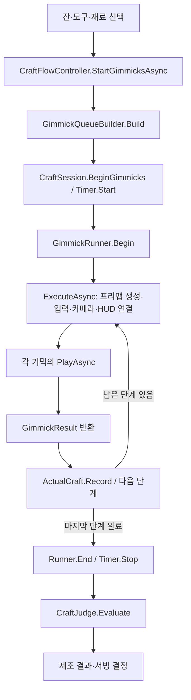

# 현재 기믹 시스템 — 작동 원리·연결·코드 안내

확인일: 2026-11-03. 현재 작업 트리의 C# 코드, `Play.unity`의 직렬화 참조, 실행 프리팹과 CSV를 기준으로 작성했다. 커밋 전 UI 수정도 포함한다.

## 1. 먼저 알아둘 실제 연결

**본편 셰이크는 `NewShakingMinigame.prefab`의 `ShakingManagerNew`다.** A/D 2레인 구현인 `RhythmShakingMinigame.prefab`은 존재하지만 현재 `Play.unity`의 실행 목록에는 연결되어 있지 않다. 최근의 리듬 진행판 UI 수정은 이 대체 프리팹에 적용된 상태다.

| 기믹 | 현재 Play 실행 프리팹 | 제어 코드 | 상태 |
| --- | --- | --- | --- |
| Open / 병따기 | `04.Cap/NewCapGame.prefab` | `CapManager` | 연결됨 |
| Pour / 따르기 | `03.Pour/NewPourGame.prefab` | `PourManager` | 연결됨 |
| Shake / 셰이크 | `01.Shake/NewShakingMinigame.prefab` | `ShakingManagerNew` | 연결됨. 경로 위 이동 노드 클릭 방식 |
| Stir / 스터 | `02.Stir/NewStirGame.prefab` | `StirManager` | 연결됨 |
| FillUp / 필업 | Pour 프리팹 재사용 | `PourManager` | 전용 항목이 없으면 실행기가 Pour로 대체 |
| Squeeze / 스퀴즈 | 등록 없음 | 전용 실행 구현 미연결 | `AutoApply`일 때 기믹 없이 기록에 반영 |
| Powder / 파우더 | 등록 없음 | 전용 실행 구현 미연결 | `AutoApply`일 때 기믹 없이 기록에 반영 |
| 대체 셰이크 | `01.Shake/RhythmShakingMinigame.prefab` | `ShakingRhythmManager` | 준비된 A/D 2레인 구현. 본편 미연결 |

위 프리팹 경로의 공통 앞부분은 `Assets/01.Game/03.Content/08.Prefabs/01.Crafting/02.Minigames/`다.

연결을 확인할 곳은 [Play.unity](../Assets/01.Game/01.Scenes/Play.unity)의 `GimmickRunner.prefabs`다. 프리팹 파일명이나 코드 클래스명만으로 본편 사용 여부를 판단하면 안 된다.

개발용 `Assets/02.Dev/01.Scenes/01.Minigames/CraftPrep.unity`도 같은 네 프리팹을 가리킨다. 다만 이 씬의 `GimmickRunner.inputRouter`는 비어 있고 라우터 컴포넌트도 없다. 현재 `GimmickRunner.Begin()`은 라우터를 필수로 검사하므로, 이 씬에서 제조 전체 루프를 실행하면 연결 오류가 날 수 있다.

## 2. 제조 전체 실행 흐름



| 책임 | 코드 | 하는 일 |
| --- | --- | --- |
| 제조 전체 소유 | [CraftFlowController.cs](../Assets/01.Game/02.Scripts/04.Features/01.Crafting/02.Flow/CraftFlowController.cs) | 준비 상태, 실행 순서, 취소, 결과 기록, 최종 판정과 서빙 흐름 |
| 한 번의 제조 상태 | [CraftSession.cs](../Assets/01.Game/02.Scripts/04.Features/01.Crafting/02.Flow/CraftSession.cs) | 현재 단계, `ActualCraft`, 한 잔 전체 `CraftTimer` |
| 큐 작성 | [GimmickQueueBuilder.cs](../Assets/01.Game/02.Scripts/04.Features/01.Crafting/02.Flow/GimmickQueueBuilder.cs) | 실제 선택과 레시피·선반 데이터를 보고 필요한 단계 생성 |
| 한 단계 실행 | [GimmickRunner.cs](../Assets/01.Game/02.Scripts/04.Features/01.Crafting/02.Flow/GimmickRunner.cs) | 프리팹 생성, 의존성 주입, 입력·HUD·카메라 연결, 결과 대기와 정리 |
| 기믹 계약 | [ICraftGimmick.cs](../Assets/01.Game/02.Scripts/04.Features/01.Crafting/02.Flow/ICraftGimmick.cs) | `PlayAsync(step, context, timer, token)`과 `IsManualInputActive` |
| 결과 계약 | [GimmickResult.cs](../Assets/01.Game/02.Scripts/04.Features/01.Crafting/02.Flow/GimmickResult.cs) | 수량, 성공·실패, 목표 횟수, 종료 종류, 확정 시각 |
| 최종 점수 | [CraftJudge.cs](../Assets/01.Game/02.Scripts/04.Features/01.Crafting/03.Judgement/CraftJudge.cs) | 기록된 실제 결과를 정답·밸런스 데이터와 비교 |

`GimmickRunner`는 큐 순서나 제조 기록을 소유하지 않는다. `CraftFlowController`가 각 결과를 `session.Actual.Record(result)`에 넣고 다음 단계로 이동한다.

### 큐 생성 규칙

실행 순서는 [CraftEnums.cs](../Assets/01.Game/02.Scripts/04.Features/01.Crafting/02.Flow/CraftEnums.cs)의 열거형 순서다.

```text
Open → Pour → Squeeze → Powder → Shake 또는 Stir → FillUp
```

- 직접 선택한 재료가 레시피에 있으면 해당 레시피의 동작·목표량을 쓴다.
- 레시피에 없는 재료도 빼지 않는다. 선반 데이터의 기본 동작·기본 목표로 실행하고, 추가 재료라는 사실은 최종 판정에서 처리한다.
- `RequiresOpen` 재료는 본래 동작 앞에 Open을 추가한다. 병맥주는 병따기 다음에 따르기도 수행한다.
- 믹스는 실제 선택한 도구로 결정한다. 셰이커면 Shake, 믹싱 글라스면 Stir, 도구가 없으면 믹스 단계가 없다.
- 같은 종류의 재료는 선택 순서가 유지된다. 빠진 재료를 자동으로 정답에 맞춰 보충하지 않는다.
- 스퀴즈·파우더의 `AutoApply`는 기록에만 넣는다. 이를 꺼서 직접 실행 단계가 생기면 현재 미등록된 실행 프리팹도 함께 준비해야 한다.

예: 맥주 선택 → `Open(beer) → Pour(beer)`. 진·소다수와 셰이커 선택 시에는 각 재료의 레시피 동작에 따라 `Pour → Shake → FillUp` 형태가 된다.

## 3. 입력·카메라·HUD 연결

### 입력

[InGameLifetimeScope.cs](../Assets/01.Game/02.Scripts/01.Bootstrap/InGameLifetimeScope.cs)가 제조 흐름과 실행기를 VContainer에 등록한다. 실행기는 생성한 기믹에 사운드 등 의존성을 주입한다.

본편의 [CraftGimmickInputRouter.cs](../Assets/01.Game/02.Scripts/04.Features/01.Crafting/02.Flow/CraftGimmickInputRouter.cs)는 Play 씬의 `PlayerInput` 하나를 사용한다.

```text
PlayerInput / CraftGimmick 액션 맵
  ├─ PointerPress → ICraftPointerInput → 따르기 또는 현재 본편 셰이크
  ├─ CapPress     → ICraftCapInput     → 병따기
  └─ StirUp/Right/Down/Left → ICraftStirInput → 스터
```

| 액션 | 현재 입력 에셋의 기본 바인딩 |
| --- | --- |
| PointerPress | 마우스 왼쪽 버튼 |
| CapPress | 마우스 왼쪽 버튼 / Space |
| StirUp | W / 위쪽 화살표 |
| StirRight | D / 오른쪽 화살표 |
| StirDown | S / 아래쪽 화살표 |
| StirLeft | A / 왼쪽 화살표 |

입력 에셋은 [PlayerInput.inputactions](../Assets/01.Game/05.Settings/01.Input/PlayerInput.inputactions)다. 키 변경 시스템의 적용 여부도 함께 확인한다.

- 제조 시작 시 `CraftGimmick`, 종료 시 `Play` 액션 맵으로 전환한다.
- 생성한 프리팹 내부의 독립 테스트용 `PlayerInput`은 비활성화해 중복 입력을 막는다.
- `Bind()`는 현재 프리팹의 수신자를 찾고, `Unbind()`는 포인터 해제와 수신자 정리를 수행한다.
- 옵션 창이 열려 있으면 라우터는 새 입력을 전달하지 않는다.
- 독립 테스트 씬에서는 각 InputHandler가 자체 입력 경로를 쓴다.

### 화면과 정리

`GimmickRunner`는 `gimmickRoot`에 프리팹을 만들고, 기믹 전용 카메라를 켠다. 지정된 바 UI 캔버스를 잠시 숨겼다가 제조 종료 시 이전 상태로 되돌린다.

- 전용 카메라는 메인 카메라의 투영 설정을 복사한다.
- [CraftGimmickStage.cs](../Assets/01.Game/02.Scripts/04.Features/01.Crafting/02.Flow/CraftGimmickStage.cs)는 기믹 내부가 사용할 카메라를 찾게 한다.
- ScreenSpaceOverlay 캔버스의 정렬 순서를 올리고 공통 HUD를 그보다 위에 둔다. 월드 스프라이트와 모든 캔버스를 일괄 이동시키는 방식은 쓰지 않는다.
- `ExecuteAsync()`의 `finally`에서 현재 기믹 참조, 입력, HUD 연결과 생성한 인스턴스를 정리한다.
- 취소 토큰은 각 `PlayAsync()`의 대기를 풀고, 바깥 흐름의 `finally`가 제조 화면을 복원한다.

### 공통 HUD

[CraftGimmickHud.cs](../Assets/01.Game/02.Scripts/04.Features/01.Crafting/05.UI/CraftGimmickHud.cs)는 현재 기믹을 다음 계약으로 읽는다.

| 계약 | 제공하는 값 |
| --- | --- |
| `ICraftGimmickProgress` | 일반 진행 문자열과 목표 도달 표시 |
| `ICraftGimmickQuantityProgress` | 분리된 목표량·현재량, 번역된 재료 이름, 기울기·유량 범위 |
| `ICraftGimmickManualEnd` | 현재 종료 가능 여부와 `EndNow()` |
| `ICraftGimmickOwnHud` | 기믹 자체 UI가 맡은 항목. 공통 HUD는 해당 항목을 숨김 |

이 계약들은 [ICraftGimmickProgress.cs](../Assets/01.Game/02.Scripts/04.Features/01.Crafting/02.Flow/ICraftGimmickProgress.cs)와 [ECraftHudPart.cs](../Assets/01.Game/02.Scripts/04.Features/01.Crafting/05.UI/ECraftHudPart.cs)에 있다.

새 Play HUD는 1280×720을 기준으로 균등 배율을 적용한다. 따르기·필업은 수량/재료/기울기/종료 버튼을 쓰며, 셰이크·스터는 중복 진행 문자열과 공통 다음 버튼을 숨긴다. 병따기는 진행 안내와 다음 버튼을 자체 UI가 맡는다.

`ProgressTarget`과 `NextControl`은 튜토리얼이 강조 대상을 찾는 접근점이다. 새 수량 패널을 연결하면 `ProgressTarget`은 수량 패널 전체를 가리킨다.

## 4. 기믹별 작동 원리

### 4.1 병따기 — CapManager

주요 코드: [CapManager.cs](../Assets/01.Game/02.Scripts/04.Features/02.Minigames/05.Cap/CapManager.cs), [CapOpenRules.cs](../Assets/01.Game/02.Scripts/04.Features/02.Minigames/05.Cap/CapOpenRules.cs), [CapInputHandler.cs](../Assets/01.Game/02.Scripts/04.Features/02.Minigames/05.Cap/CapInputHandler.cs).

```text
Ready ─첫 입력→ Power ─초록 구간 입력 성공→ PowerDone
PowerDone ─0.45초→ Rhythm ─링 타이밍 성공→ Pop
실패 누적 3회 → Broken ─1.2초→ Power
Pop ─탄산 2.05초 경과→ 자체 다음 버튼 활성 → Finish
```

- `CapOpenRules`가 입력과 시간으로 상태를 바꾸고, `CapOpenView`·`CapCanvasLayer`·`CapCarbonation`이 그림을 그린다. `CapOpenAudio`는 판정음을 담당한다.
- 힘 조절 중심은 0.78, 성공 오차는 ±0.152다. 힘 perfect 오차는 ±0.08이다.
- 링 목표 시점은 1.1초, 성공 오차는 ±0.14초다. 1.24초를 지나면 시간 초과 실패가 된다.
- 최종 perfect에는 힘 perfect와 링 오차 ±0.065초가 모두 필요하다.
- 힘·링 실패는 같은 실패 누적에 들어간다. 3회면 병이 깨지고 새 병으로 재시도한다. 전체 실패 수는 유지된다.
- 성공해도 바로 다음 기믹으로 넘어가지 않는다. 탄산 연출 후 자체 다음 버튼을 눌러 `Finish()`해야 결과 대기가 끝난다.
- 결과는 `GimmickResult.Open`: 시도 수 `Failures + 1`, 전체 실패 수, 개봉 여부, 확정 시각을 담는다. 결과 분류 `AutoSuccess`는 버튼 클릭 유무를 뜻하지 않는다.
- 병따기 전체 시간은 제조 공통 타이머에서 제외된다(`IsManualInputActive == false`).

수치는 `NewCapGame.prefab`의 `tuning`에 저장되어 있다. 주석에 남은 ‘성공 즉시 종료’ 설명보다 현재 `CanFinish → EndNow → Finish` 경로를 기준으로 본다.

### 4.2 따르기·필업 — PourManager

주요 코드: [PourManager.cs](../Assets/01.Game/02.Scripts/04.Features/02.Minigames/04.Pour/PourManager.cs), [PourInputHandler.cs](../Assets/01.Game/02.Scripts/04.Features/02.Minigames/04.Pour/PourInputHandler.cs), [BottleTiltController.cs](../Assets/01.Game/02.Scripts/04.Features/02.Minigames/04.Pour/BottleTiltController.cs).

```text
작업 영역 누름 → 병 들기 → 포인터 방향으로 기울기 변경
 → 임계각 이상에서 유량·수량 증가 → 놓으면 병 세우기
 → 따르기 마치기 → FinishPour → GimmickResult.Quantity
```

- 버튼 같은 조작 UI 위에서 누른 입력은 병 드래그로 처리하지 않는다.
- `BottleTiltController`는 병의 들기·회전·복귀만 담당하고, `PourManager`가 유량과 투입량을 계산한다.
- 본편 수량은 입자 수가 아니라 방출량의 시간 적분이다. SPH 파티클은 물줄기와 잔 속 액체를 표현한다.
- 현재 실행 프리팹 값은 **따르기 시작각 95°, 최대 유량각 110°, 최대 기울기 140°**다. C# 필드 초기값 45°/75°/120°와 다르므로 Inspector 값을 확인해야 한다.
- 기본 방출률은 CSV의 70 ml/s지만, 프리팹의 `quantityAccumulateMultiplier`가 0.25다. 따라서 현재 최대 수량 증가율은 조건이 충족될 때 **17.5 ml/s**다.

```text
flow = Clamp01(InverseLerp(95°, 110°, 현재각도))
증가 ml = 70 × flow × 0.25 × dt
1 oz = 30 ml
```

- 방출과 물리는 1/120초 스텝으로 진행하며 프레임당 최대 4스텝이다.
- 병 그림은 재료 ID로 찾고 액체 색은 선반 데이터에서 읽는다. 잔은 현재 프리팹의 고정 리소스를 사용한다.
- HUD는 레시피 단위 oz/ml로 목표량과 현재량을 분리해서 표시한다. 정답 재료가 아니면 두 값은 `???`로 가린다.
- 목표 도달은 표시 신호이며 자동 종료 조건이 아니다. 플레이어가 마치기를 누를 때 실제 수량을 확정한다.
- `FillUp`도 같은 프리팹·코드를 쓴다. 큐의 위치와 결과의 `Type`만 FillUp으로 유지된다.

표현 코드: [SphLiquidRenderer.cs](../Assets/01.Game/02.Scripts/04.Features/02.Minigames/04.Pour/SphLiquidRenderer.cs), `Sph/SphSimulation.cs`, `LiquidProfile.cs`, `LiquidAppearance.cs`, `BottleSilhouette.cs`.

### 4.3 본편 셰이크 — ShakingManagerNew

주요 코드: [ShakingManagerNew.cs](../Assets/01.Game/02.Scripts/04.Features/02.Minigames/02.Shake/ShakingManagerNew.cs), [ShakingStrikeNode.cs](../Assets/01.Game/02.Scripts/04.Features/02.Minigames/02.Shake/ShakingStrikeNode.cs), [ShakingCatergoryNodeCreator.cs](../Assets/01.Game/02.Scripts/04.Features/02.Minigames/02.Shake/ShakingCatergoryNodeCreator.cs).

```text
첫 클릭 → MinigameInputHandler.startGame → VoidEventListener → StartGame
이후 클릭 → onPressEvent → VoidEventListener → ClickEvent
 → 이동 노드와 가장 가까운 타겟 거리 검사 → 성공/실패 1회 기록
 → 성공+실패가 목표 횟수에 도달 → CompleteMade
```

- `ShakeLineCreator`가 4개 기준점의 경로를 만든다.
- `ShakingStrikeNode`는 `AudioSettings.dspTime`과 60 BPM을 기준으로 `0 → 1 → 2 → 3 → 2 → 1` 순서로 이동한다.
- `ClickEvent()`가 동적 타겟과 고정 타겟에서 가장 가까운 노드를 찾는다. 현재 프리팹 `judgeRange`는 월드 거리 0.25다.
- 성공한 동적 타겟은 풀에 반환한다. 성공 시 효과음·캐릭터 애니메이션·타격 효과를 재생한다.
- 성공과 실패 클릭이 모두 시도 한 칸을 소비한다. CSV `shake_target_stacks=20`이 현재 목표이며, 데이터를 못 읽을 때만 프리팹 폴백 15를 쓴다.
- 목표 횟수를 채우면 `GimmickResult.Mix(Shake, 성공 수, 실패 수, 목표 수, 종료 종류, 시각)`를 반환한다.
- 기존 `IMiniGameController`와 이벤트 채널 연결도 남아 있다. 본편의 다음 단계 진행과 제조 기록은 `PlayAsync` 반환 경로를 기준으로 봐야 한다.

기본 입력은 마우스 클릭이다. 현재 본편 셰이크에 A/D·Perfect 75ms·콤보 배속 규칙을 적용해 설명하면 다른 구현을 설명하는 것이 된다.

### 4.4 스터 — StirManager

주요 코드: [StirManager.cs](../Assets/01.Game/02.Scripts/04.Features/02.Minigames/03.Stir/StirManager.cs), [StirInputHandler.cs](../Assets/01.Game/02.Scripts/04.Features/02.Minigames/03.Stir/StirInputHandler.cs), `StirDirection.cs`.

```text
첫 W → 시작(이 입력은 회전 횟수에서 제외)
 → D → S → A → W = 첫 한 바퀴 성공
 → 성공/실패 기록 → 현재 위치 기준으로 다음 한 바퀴
 → 판정 10회 누적 → Complete → GimmickResult.Mix
```

- 현재 CSV는 한 바퀴 제한 2초, 목표 판정 10회다. 데이터를 못 읽을 때 쓰는 프리팹 폴백도 2초/10회다.
- 현재 방향의 시계 방향 이웃 키만 정답이다. 맞힐 때마다 스푼이 90° 회전하고 얼음에 회전 충격을 준다.
- 잘못된 방향 또는 시간 초과는 실패 한 칸이다. 실패한 키 방향으로 위치를 옮기지 않고, 마지막으로 맞힌 현재 방향을 다음 시도의 기준으로 쓴다.
- 한 시도는 현재 기준에서 4번 올바르게 눌러야 성공한다. 성공·실패 모두 목표 횟수에 포함된다.
- 옵션 창, 앱 일시정지, 포커스 상실 동안에는 스터 판정 타이머를 멈춘다.
- `Completed` 이벤트가 `PlayAsync`의 대기를 풀고 결과를 반환한다. 현재 결과의 `EndType`은 `AutoTarget`으로 고정되어 있다.
- `EndNow()` API는 남아 있지만 새 공통 HUD에서는 셰이크·스터 다음 버튼을 숨기므로 기본 화면의 조기 종료 버튼으로 노출되지 않는다.

| 스터 표시 코드 | 역할 |
| --- | --- |
| [StirLayoutView.cs](../Assets/01.Game/02.Scripts/04.Features/02.Minigames/03.Stir/StirLayoutView.cs) | 웹 1280×720 좌표에서 화면 크기에 맞춰 배치 계산 |
| [StirHudView.cs](../Assets/01.Game/02.Scripts/04.Features/02.Minigames/03.Stir/StirHudView.cs) | 결과 게이지·시작 안내·시간 표시, 공통 HUD와 중복 숨김 |
| `StirGlassView` / `StirKeyBadge` | 숟가락 방향·키 상태·원형 남은 시간 |
| `StirGaugeView` | 성공/실패 칸과 다음 판정 위치 |
| `StirAnimationView` | 캐릭터와 확대창의 프레임 연결 |
| `StirIceSwirl` / `StirSideGlassView` | 얼음 회전과 측면 표현 |

배치를 Inspector에서 옮겨도 `StirLayoutView`가 활성화되거나 Canvas 크기가 바뀌면 위치를 다시 계산한다. 키캡은 `StirKeyBadge.artworkSize`가 지정되어 있으면 그 크기를 사용한다.

### 4.5 준비된 대체 셰이크 — ShakingRhythmManager

코드: [ShakingRhythmManager.cs](../Assets/01.Game/02.Scripts/04.Features/02.Minigames/02.Shake/ShakingRhythmManager.cs), [ShakingRhythmRules.cs](../Assets/01.Game/02.Scripts/04.Features/02.Minigames/02.Shake/ShakingRhythmRules.cs).

본편의 현재 연결과 구분해서 유지보수한다. 독립 `Assets/02.Dev/01.Scenes/01.Minigames/NewShaking.unity`와 리듬 프리팹을 확인한다.

| 항목 | 이 대체 구현의 기본값 |
| --- | --- |
| 입력 | A/D 레인, 시작 Space/A/D 또는 UI |
| 노트 수 | 20 |
| 첫 도착 시간 | 1.8초 |
| 생성 간격 | 이동 시계 기준 0.6초 |
| Perfect / Good | 오차 ±0.075초 / ±0.18초 |
| 콤보 배속 | 0~4: 1배, 5~9: 1.25배, 10 이상: 1.5배 |
| 결과 분모 | 목표 노트 수 + 빈 타이밍 입력 수 |

음악 BPM 대신 자체 이동 시계를 쓴다. 최근 추가한 `Rhythm Reference Content`가 기존 노트·판정선·버튼 묶음을 같은 부모 좌표계에서 균등 축소한다.

본편에 사용하려면 `GimmickRunner.prefabs`의 Shake 참조를 바꾸고 입력·튜토리얼·점수·화면을 함께 검증해야 한다. 이번 문서 작성에서는 연결을 바꾸지 않았다. 자세한 기존 설명은 [리듬 셰이크 문서](../../docs/shaking-rhythm-integration.md)를 참고한다.

## 5. 제조시간과 결과 점수

[CraftTimer.cs](../Assets/01.Game/02.Scripts/04.Features/01.Crafting/02.Flow/CraftTimer.cs)는 한 잔 전체에 하나만 있다. 실행기가 현재 기믹의 `IsManualInputActive`가 true일 때만 `Tick(Time.deltaTime)`을 넣는다.

| 현재 본편 기믹 | 제조시간에 들어가는 구간 |
| --- | --- |
| 병따기 | 전체 제외 |
| 따르기·필업 | 화면에서 조작 가능한 동안. 실제 드래그 중인 시간만 세는 것은 아님 |
| 본편 셰이크 | `isPlay` 동안. 첫 클릭을 기다리는 구간도 포함 |
| 스터 | 첫 시작 입력 이후, 완료 전이며 포커스·옵션 상태가 허용하는 동안 |

기믹이 반환하는 것은 최종 등급이 아니라 실제 수행 기록이다.

| 종류 | 기록 | 기본 기믹 점수 계산 |
| --- | --- | --- |
| 병따기 | 완료 여부, 시도 수, 실패 수 | 완료 시 `max(0, 100 - 실패 수 × 15)` |
| 따르기·필업 | 목표 단위, 실제 수량 | `abs(실제-목표)/목표`를 수량 구간표에 대입 |
| 셰이크·스터 | 성공 수, 실패 수, 목표 판정 수 | `성공 수 / 목표 수 × 100` |

`CraftJudge`는 이 점수들을 종류별로 묶고 가중치를 적용한 뒤 잔·도구·재료 누락/추가·시간 초과 감점을 함께 반영한다. 기믹 하나의 점수와 칵테일 최종 점수는 구분해야 한다.

## 6. 수치를 바꾸거나 연결을 수정할 때

| 바꾸려는 것 | 먼저 볼 곳 |
| --- | --- |
| 실제 실행할 프리팹 | `Play.unity → GimmickRunner.prefabs` |
| 실행 순서 | `CraftEnums.cs` + `GimmickQueueBuilder` |
| 재료별 행동·병따기 필요 여부 | [shelf_items.csv](../Assets/StreamingAssets/csv/craft/shelf_items.csv)와 `NewShelfItemDataSO` |
| 재료 목표량·단위·자동 반영 | [recipes.csv](../Assets/StreamingAssets/csv/craft/recipes.csv)와 `NewCocktailDataSO` |
| 스택 수·유량·단위 환산·감점 | [balance_config.csv](../Assets/StreamingAssets/csv/settings/balance_config.csv)와 `NewBalanceDataSO` |
| 병따기 세부 판정 | `NewCapGame.prefab → CapManager.tuning` |
| 따르기 체감 속도·각도 | `NewPourGame.prefab → PourManager`와 `BottleTiltController` |
| 본편 셰이크 거리 판정 | `NewShakingMinigame.prefab → judgeRange` |
| 대체 리듬 셰이크 타이밍 | `RhythmShakingMinigame.prefab`의 Inspector + `ShakingRhythmRules` |
| 공통 HUD 표시·참조 | `CraftGimmickHud` + Play 씬의 HUD 오브젝트 |
| 스터 배치·키캡 크기 | `StirLayoutView` / `StirKeyBadge.artworkSize` |

**C# 초기값을 바꿔도 이미 프리팹에 저장된 Inspector 값은 바뀌지 않는다.** 데이터가 로드되면 CSV 기반 값이 우선하는 항목과 Inspector 값이 직접 사용되는 항목도 구분해야 한다.

기존 병따기·따르기·본편 셰이크·스터 클래스에는 `IMiniGameController`, `CraftStationData`, Serve/Retry 등 옛 독립/대화 경로가 함께 남아 있다. 본편 연결을 추적할 때는 `ICraftGimmick.PlayAsync → GimmickResult → ActualCraft.Record`를 먼저 따라간다.

## 7. 최근 UI 변경과 검증 범위

- 공통 수량 HUD와 스터 UI는 본편 경로에 반영되어 있다.
- 리듬 셰이크 UI는 대체 프리팹에 반영되어 있으며 본편 Shake 참조는 기존 프리팹을 유지한다.
- UI 리소스 대조와 적용 도구는 [기믹 UI 변경 문서](Gimmick_UI_Web_2026-11-03.md)에 정리했다. `align-gimmick-ui.cjs --apply`는 저장된 기준 배치로 다시 쓰므로 수동 수정 후 실행에 주의한다.
- 원본 리소스 136개를 확인했다. 135개는 파일이 같고, `cup3.png` 한 개는 인코딩만 다르며 픽셀이 같다. 합성 미리보기 18개는 프로젝트에 없다.
- 현재 코드는 런타임 전체·에디터 전체 C# 컴파일을 통과했다. 씬·프리팹 구조와 리소스 검사도 통과했다. 본편의 처음부터 끝까지 실제 플레이 검증은 미실행이다.
- 이번 문서의 연결 표는 실제 씬 GUID를 프리팹 `.meta`와 대조했다. 과거 문서의 계획·파일명보다 현재 연결 표를 우선한다.
