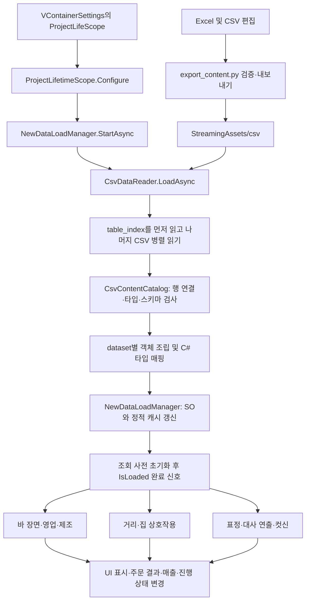
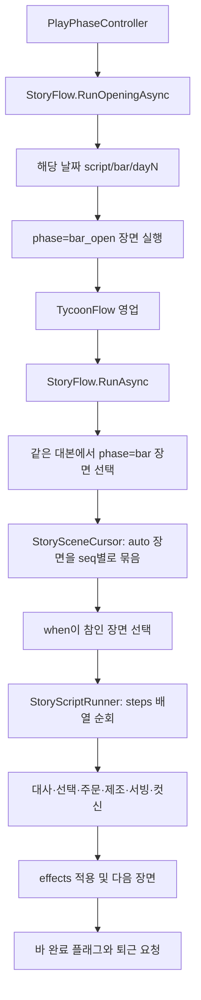
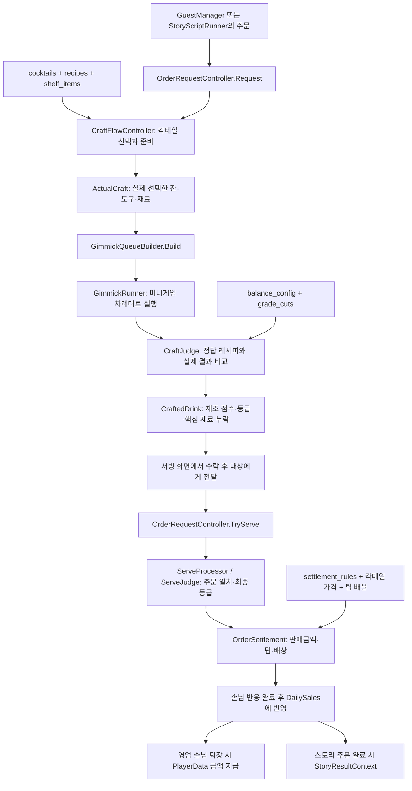

**Human Bartender — CSV 시스템별 연결과 실행 흐름**

분석 기준: 2026-10-19 작업 디렉터리의 코드·CSV·설정. Unity 6000.3.14f1.

런타임 CSV는 `HumanBartender/Assets/StreamingAssets/csv` 아래 **47개 파일 = 편집 표 42개 + 구조용 표 5개**이며, `data_sets.csv`에는 **38개 데이터 묶음**이 있다. 파일 수와 데이터 묶음 수는 다르다. 하나의 CSV에 여러 데이터 묶음이 섞이고, 하나의 묶음은 여러 CSV를 합쳐 만들기도 한다.

이 문서는 현재 소스에서 확인한 구조다. 실제 플레이를 실행해 모든 장면·프리팹·Addressables 연결을 관찰한 결과는 아니다. Python 구조 검증은 통과했으며, Unity 컴파일·Editor 테스트·런타임 검증은 이번 작업에서 실행하지 않았다. 게임 코드나 기존 콘텐츠는 수정하지 않았다.

**1. 전체 구조: 파일을 읽는 과정과 게임을 실행하는 과정**



실제 연결 순서는 다음과 같다.

1. `VContainerSettings.asset`의 `RootLifetimeScope` GUID가 `ProjectLifeScope.prefab`을 가리킨다.
2. `ProjectLifetimeScope.Configure()`가 `NewDataLoadManager`를 등록한다. 로더의 `IAsyncStartable.StartAsync()`는 `LoadDataAsync()`를 호출한다.
3. `CsvDataReader`는 `system/table_index.csv`부터 읽는다. 그 표에 있는 파일 경로와 나머지 메타데이터 경로를 모아 `UniTask.WhenAll`로 읽는다. 파일을 story → craft → guests 순서로 하나씩 실행하는 구조가 아니다.
4. `CsvContentCatalog`는 헤더, 행 ID, template, 부모 연결, 순환, 저장 순서, 값 타입을 검사하고 목록·사전·중첩 객체를 조립한다. 런타임 소비자가 없는 묶음도 구조 검사에는 포함된다.
5. `catalog.Read<T>(datasetId)`가 조립된 데이터를 기존 C# 모델로 변환한다. `JsonProperty`는 필드명 매핑에 재사용하지만 이 콘텐츠 경로에서 JSON 파일을 만들거나 JSON 역직렬화를 실행하지 않는다.
6. 로더는 각 대상에 넣을 값을 `pending`에 모은 뒤 SO 필드와 정적 캐시에 반영한다. 바 대본은 날짜별 캐시, 거리·집 대본은 `StreetStory`/`HomeStory`, 나머지 다수는 `New*DataSO`에 들어간다.
7. 거리·장소·상호작용 조회 사전을 초기화한 후 `EndLoad()`가 `IsLoaded`와 완료 신호를 설정한다.
8. `StoryFlow`, `TycoonFlow`, `InteractiveEntityManager`, `OutsideStoryFlow` 등의 실행 경로가 로딩 완료를 기다린 뒤 데이터를 사용한다.

필수 데이터나 대상 SO가 없으면 예외로 실패 신호를 전달한다. 바 대본의 **데이터 묶음 자체가 없는 경우**만 optional 로드로 건너뛸 수 있으며, 등록된 CSV의 구조 오류까지 무시하는 것은 아니다. 재로딩은 `GameProgressionService.CanReloadData` 조건을 확인한다.

근거: [루트 설정][root-settings], [루트 스코프 등록][scope], [로더][loader], [파일 읽기][reader], [CSV 조립][catalog], [로더 프리팹][loader-prefab].

**2. CSV를 연결하는 키**

| 열 | 역할 | 혼동하면 안 되는 것 |
|---|---|---|
| `dataset_id` | `cocktails`, `script/bar/day1` 같은 데이터 묶음 | 디스크의 CSV 파일 경로와 다르다 |
| `row_id` | CSV 행을 연결하는 내부 고유 ID | 게임에서 쓰는 `id`와 다르다 |
| `parent_id` | 부모 행의 `row_id` | `@묶음명`은 최상위 연결에 쓰인다 |
| `parent_field` | 부모의 어느 필드에 붙는지 | `steps`, `recipe`, `tags` 등 중첩 위치 |
| `source_order` | 같은 표·부모·필드 아래 자식 목록 조립 순서 | 어떤 실행기는 이 배열 순서를 그대로 사용한다 |
| `template_id` | 행에 포함되는 필드·중첩 구조의 형식 | 뒤의 번호는 실행 순서가 아니다 |
| `id` / `scene_id` / `dialogue_id` | 게임 동작에서 찾는 콘텐츠 ID | `row_id`로 대체하면 안 된다 |
| `source_id` | 씬에 배치된 상호작용 엔티티와 매칭하는 키 | `dataset_id`와 별개다 |
| `seq` / `flow_seq` | 해당 시스템이 해석하는 순서 | 모든 실행기가 동일하게 정렬하지 않는다 |
| `when` / `effects` | 조건 검사 / 플레이어 상태 변경 | 읽기만 하는 설정값과 달리 실행 시 평가된다 |

실제 레시피 예:

```text
craft/cocktails.csv
  row_id = migration_cocktails_0
  id     = gin_tonic
       │ parent_id로 연결
       ▼
craft/recipes.csv
  source_order=0, action=pour,    ingredient=gin,        qty=1.5
  source_order=1, action=fill_up, ingredient=soda_water, qty=4
       ▼
NewCocktailData(Id=gin_tonic).Recipe[]
       ▼
제조 큐 생성 및 제조 결과의 정답 비교
```

빈 셀과 `\N`은 null, `\E`는 빈 문자열이다. `0`·`false`는 null이 아니다. 쉼표·따옴표·실제 줄바꿈은 CSV 파서가 처리한다.

**3. 공통 기반 — system 5개**

| CSV | 역할 | 연결 결과 |
|---|---|---|
| `system/table_index.csv` | 표 이름과 실제 상대 파일 경로 | 읽을 콘텐츠 파일 목록 |
| `system/columns.csv` | 열 이름·순서·타입 | 헤더와 값 검사 |
| `system/row_formats.csv` | record/object/cell/children 등의 조립 규칙 | 중첩 객체·배열·사전 복원 |
| `system/data_sets.csv` | dataset ID와 루트 template 연결 | `catalog.Read<T>(id)`의 입구 |
| `system/balance_root.csv` | 밸런스 하위 표들의 부모 행 | 하나의 `NewBalanceDataBase` |

`balance_root`는 수치가 아니라 연결용 루트다. 실제 수치는 settings 하위 표에 있다. `data_sets.csv`의 `sha256`은 현재 C# 카탈로그의 실행 흐름에서 파일 무결성 검사에 사용되지 않는다.

근거: [파일 읽기][reader], [스키마 해석과 Build/ConvertValue][catalog].

**4. 스토리·선택지 — story 7개**

| CSV | 역할 | 실제 연결 |
|---|---|---|
| `story/script_files.csv` | 대본 묶음의 루트 | 바 날짜별 대본, 거리·집 등의 루트 |
| `story/scenes.csv` | 장면 ID·날짜·단계·조건·순서·시작 방식 | 바 `StorySceneCursor`, 거리·집 장면 선택 |
| `story/steps.csv` | 대사·입퇴장·선택·주문·제조·서빙·효과 | 바 `StoryScriptRunner`, 거리·집 `DialogueRunner` |
| `story/bar_choice_groups.csv` | 바 선택지 묶음의 키 | 대본의 `Choices` 사전 |
| `story/bar_choices.csv` | 선택 문구·조건·효과·이동 장면 | 바 선택 UI → effects → goto |
| `story/street_choices.csv` | 거리 선택지와 결과 스텝의 부모 | 거리 선택 UI → `ResultSteps` 재귀 실행 |
| `story/cutscenes.csv` | 컷신 ID·종류·리소스 키 | `CutSceneManager`의 CSV 조회 경로 |

물리적으로는 같은 `scenes.csv`와 `steps.csv`여도 `dataset_id` 및 template에 따라 서로 다른 C# 모델과 실행기를 사용한다.

바 실행:



- 개점 대화는 현재 1~3일차에 실행한다. 0일차는 영업을 건너뛰고 바 대본의 튜토리얼 경로로 간다.
- `StorySceneCursor`는 선택된 phase에서 `trigger=auto`인 장면만 모아 `seq` 오름차순으로 처리한다. 같은 seq에서 조건이 참인 장면이 둘 이상이면 오류다. 이미 지난 seq 묶음은 되돌아가서 다시 평가하지 않는다.
- `StoryScriptRunner.PlaySceneAsync()`는 `scene.Steps`를 그대로 순회한다. **바 스텝은 `seq` 재정렬이 아니라 CSV 조립 결과인 `source_order` 순서로 돈다.** `seq`는 effects 중복 방지 토큰에도 쓰인다.
- 지원 스텝은 `say`, `enter`, `exit`, `effect`, `choice`, `order`, `craft`, `serve`, `timeline`, `tutorial`, `coaster`, `end_part` 경로에서 처리한다. 미지원 스텝은 예외로 실패한다.
- 바 선택지는 `step.arg`로 선택지 묶음을 찾는다. 조건을 검사해 잠긴 항목을 표시하고, 선택한 항목의 effects를 적용한 뒤 goto 대상을 반환한다. goto로 옮겨 간 후 원래 장면의 나머지 스텝으로 복귀하지 않는다.
- `order → craft → serve`는 순서가 있는 작업이다. serve에서 완료 결과를 기다린 다음 `StoryResultContext`에 제조 등급·최종 등급·주문 일치 여부를 담아 이후 조건에 제공한다.

실제 1일차 예: `script/bar/day1`에는 `campaign_d1_bar_open`과 `campaign_d1_bar`가 있다. 개점 장면의 첫 스텝은 `enter(chris, R)`, 다음은 chris/luna의 `say`다. 두 장면의 seq는 각각 1이지만 phase가 달라 충돌하지 않는다.

근거: [하루 국면][play-phase], [바 StoryFlow][story-flow], [장면 커서][scene-cursor], [바 스텝 실행기][story-runner].

**5. 거리·집 상호작용 — interaction 3개**

| CSV | 역할 | 실제 연결 |
|---|---|---|
| `interaction/interact_points.csv` | source ID·장소·등장 조건·상호작용 조건·행동 | `InteractiveEntityManager.SelectDefinition()` |
| `interaction/dialogue_flows.csv` | 대상별 대화 장면·날짜·조건·순서·반복 여부 | `SelectDialogue()` → street 장면 |
| `interaction/spots.csv` | 장소 ID와 설명 | 씬의 `SpotPoint` 좌표와 합쳐 사용 |

```text
CSV 로딩 완료
  → OutsideSpotManager / 씬 SpotPoint 등록
  → InteractiveEntityManager가 씬 엔티티의 source_id 수집
  → 같은 source_id에서 priority 높은 행부터 phase·spawn_when 검사
  → spot_id를 실제 씬 Transform과 연결
  → interact_when 검사
  ├─ dialogue: flow_seq → day/when/once → scene_id → InteractiveNPCEntity
  │              → DialogueRunner.PlayOutsideAsync(steps)
  ├─ transition: InteractEntrance → OutsideActions → GameProgressionService
  └─ scene: InteractiveTriggerEntity → OustideTimelineManager
```

같은 source ID의 priority가 같으면 `id` 순서로 결정한다. 대화 흐름은 `flow_seq`, 동률이면 `scene_id`로 정렬한다. `once` 기록은 `InteractiveEntityManager`의 실행 중 `HashSet`에 쌓이므로, 이것만 보고 저장 파일까지 유지되는 일회성 조건이라고 해석하면 안 된다.

거리·집에는 위의 엔티티 경로 외에 **`OutsideStoryFlow`가 scenes를 직접 선택하는 경로**도 있다.

```text
StreetStory 또는 HomeStory
  → runtime_scene + day + route + when + completion_flag 확인
  → start_mode에 따라 자동 접근 / 상호작용 버튼 / 야간 수동 실행
  → 필요 시 scenes의 x/y/radius로 근접 검사
  → DialogueRunner.PlayOutsideAsync(scene.Steps)
  → OutsideDialoguePresenter → UIDialogueTextView
  → 성공 시 completion_flag 설정
```

따라서 장소 데이터는 두 방식이다. 엔티티의 위치는 `spots.csv` ID와 씬 `SpotPoint`로 결정하고, 직접 실행하는 거리·집 스토리의 근접 조건은 `scenes.csv`의 x/y/radius를 사용한다.

거리 스텝은 `seq`로 정렬한다. 단, 모든 seq가 0인 기존 결과 스텝은 조립된 배열 순서를 유지한다. 선택지의 `ResultSteps` 실행이나 goto 후에는 현재 배열의 나머지 스텝으로 복귀하지 않는다. `say`, `timeline`, `effect`, `set_state`, `choice`, `goto`를 처리하며, 마지막에 해당 스텝의 effects를 적용한다.

근거: [엔티티 선택·연결][entities], [NPC 상호작용][npc], [거리·집 직접 실행][outside-flow], [거리 스텝 실행][dialogue-runner], [이동 실행][entrance], [이동 ID 매핑][outside-actions].

**6. 손님 영업 — guests 9개**

| CSV | 역할 | 실제 연결 |
|---|---|---|
| `guests/random_waves.csv` | 날짜별 일반 손님·등장 순서·주문·성격 | `GuestManager.BuildGuestQueue()` |
| `guests/regular_slots.csv` | 날짜별 단골·등장 순서·지정 주문 | 같은 큐에 합류, 캐릭터 외형 사용 |
| `guests/personalities.csv` | 팁·인내심·고민 확률 | 일반 손님의 `tipMultiplier/patienceMultiplier/thinkChance` |
| `guests/guest_settings.csv` | 성별 기본 외형 조합 | `NewGuestBodyDataBase.Defaults` |
| `guests/guest_parts.csv` | 부위·리소스·가중치 | `GuestAppearanceBuilder` |
| `guests/guest_personalities.csv` | 부품별 허용 성격 | 외형 후보 필터, 빈 목록은 제한 없음 |
| `guests/guest_exclusions.csv` | 함께 쓰면 안 되는 부품 | 외형 조합 제외 |
| `guests/barks.csv` | 상황·voice ID·가중치·대사 | `ShowBark()` → 손님/플레이어 말풍선 |
| `guests/bark_situations.csv` | 상황별 기본 표정 정의 | 카탈로그 파싱은 하지만 로더의 별도 공개·소비 경로 미확인 |

```text
TycoonFlow.RunAsync
  → CSV 완료 대기
  → random_waves + regular_slots를 오늘 day로 필터
  → seq 순으로 합친 손님 큐 생성
  → 첫 등장/개별 등장/자리 교체 지연을 적용
  → 빈 좌석 배정
  → 일반 손님: 성격 + 외형 조합 / 단골: character 외형
  → call → 코스터 → order 대사 → OrderRequest 등록
  → 제조 결과를 서빙
  → 감사/맛 반응 → 주문 정산 → 재주문 또는 퇴장
  → ReleaseGuest → GuestReleased
  → 남은 손님 0명 → TycoonFlow 완료
```

- 오늘 손님이 0명이면 즉시 영업을 끝낸다.
- 일반 손님의 외형은 대기열 생성 때가 아니라 착석할 때 고른다. 이미 앉은 손님과 중복되는 조합 및 exclusions를 고려한다.
- 지정 주문 ID가 유효하면 사용하고, 없거나 찾지 못하면 현재 주문 가능한 칵테일에서 무작위로 고른다.
- 일반 손님은 personalities의 배율을 사용한다. 단골의 생성 경로는 같은 성격 조회를 사용하지 않는다.
- barks는 `situation + voice_id` 후보를 찾고 가중치 추첨과 직전 대사 반복 회피를 적용한다. CSV 파일에 적힌 행 순서가 대사 재생 순서는 아니다.
- 제조 또는 차단 UI가 열려 있으면 바 운영 시계를 멈추며, 대기시간 만료도 손님 퇴장 완료로 집계된다.
- `regular_slots`의 `branch_choice`, `cameo_scene`, `must_serve`, `serve_effects`와 `random_waves.branch_choice`는 모델 필드는 있지만 현재 소비 호출을 찾지 못했다. 반면 `max_rounds`와 성격 배율은 실제 사용된다. 오래된 TODO 주석보다 현재 본문을 기준으로 구분했다.

근거: [영업 국면][tycoon], [손님 생성·주문·대사·퇴장][guest], [외형 조합][appearance].

**7. 제조·레시피·서빙 — craft 6개**

| CSV | 역할 | 실제 연결 |
|---|---|---|
| `craft/cocktails.csv` | ID·이름·가격·해금·목표 제조 조건 | 레시피 UI, 주문 선택, 제조, 서빙 가격 |
| `craft/cocktail_tags.csv` | 칵테일 하위 태그 | 레시피 태그 UI 및 일부 미니게임 표시 |
| `craft/recipes.csv` | 재료·동작·수량·단위·핵심 재료 | `NewCocktailData.Recipe` → 큐 생성·채점 |
| `craft/shelf_items.csv` | 잔·도구·재료·기본 동작·해금 | 준비 선반과 실제 선택 재료의 기믹 |
| `craft/order_rules.csv` | 데이터상 주문 조건·효과 | SO까지 로드, 현재 판정 소비 코드 미확인 |
| `craft/tastes.csv` | 데이터상 캐릭터 취향 조건 | SO까지 로드, 현재 취향 소비 코드 미확인 |



레시피는 정답 데이터이며, 실행할 기믹은 플레이어가 실제 고른 재료·도구도 반영해 생성한다. 잘못 고른 재료를 정답 재료로 자동 교체하지 않는다. 스퀴즈·파우더 등의 자동 재료는 레시피에서 가져온다.

기믹 순서는 CSV 행 순서만으로 정해지지 않는다. 현재 `ECraftGimmick`과 큐 정렬 기준은 **병따기 → 따르기 → 스퀴즈 → 파우더 → 셰이크 또는 스터 → 필업**이다. 같은 종류 안에서는 선택/추가 순서를 유지한다.

제조 채점은 `CraftJudge`가 `balance_config`의 감점·가중치와 `grade_cuts`를 사용한다. 서빙은 `ServeJudge`가 주문 불일치/핵심 재료 누락을 보고 최종 등급을 결정한다. 현재 이 경로는 `order_rules.csv`를 순회하는 방식이 아니다.

주문별 정산은 `판매가×sale_rate + 판매가×tip_rate×성격팁배율 - 판매가×refund_rate`의 각 항목을 반올림해 계산한다. 무료 주문은 주문 문맥에서 가격·팁 입력을 0으로 만든다. 손님 반응 완료 후 `DailySales`에 한 번 반영하고, 영업 손님이 퇴장할 때 손님별 합계를 `PlayerData.AddMoney()`로 지급한다. 스토리의 완료 콜백은 결과를 조건 평가기에 전달한다. 두 경로의 최종 상태 변경을 동일하다고 가정하지 않았다.

해금에도 경로 차이가 있다. 일반 메뉴/무작위 주문의 `CocktailUnlockPolicy`는 confirmed·일차·빈 unlock_when을 확인하며, 조건식이 채워진 unlock_when을 일반적으로 평가하지 않는다. 스토리 주문 선택의 일부 경로는 `IConditionUtil.CheckRequired()`를 호출한다.

근거: [제조 흐름][craft-flow], [큐 생성][queue], [기믹 순서][craft-enums], [제조 채점][craft-judge], [주문 수락·완료][orders], [서빙 처리][serve], [최종 등급][serve-judge], [정산][settlement], [해금][unlock].

**8. 캐릭터·표정·대사 출력 — characters 7개**

| CSV | 역할 | 실제 연결 |
|---|---|---|
| `characters/characters.csv` | 인물 ID·이름·이름색·역할 등 | 바/거리 화자 이름, 단골 표시 |
| `characters/character_expressions.csv` | 캐릭터 하위 표정 이름 목록 | 모델에 조립되지만 이 목록을 사용하는 런타임 참조 미확인 |
| `characters/animation_characters.csv` | 표정 사전의 캐릭터 키 | `character_anim` 등의 사전 루트 |
| `characters/expressions.csv` | 캐릭터별 표정·sprite/parts 방식 | `NewExpressionDataSO`의 표정 조회 |
| `characters/expression_parts.csv` | 표정별 파츠 clip·loop | 실제 스프라이트/애니메이션 로딩 |
| `characters/field_animations.csv` | 필드 동작·리소스 | SO까지 로드, 소비 코드 미확인 |
| `characters/dossier.csv` | 인물 정보 공개 조건·문구 | SO까지 로드, 소비 코드 미확인 |

```text
steps의 actor / arg(표정)
  → StoryScriptRunner
  → BarStoryPresenter
  ├─ characters에서 이름·색상 조회
  ├─ DialogueCharacterManager → NewExpressionDataSO
  │     → character_anim[캐릭터][표정]
  │     → CharacterLoader / ResourceLoader → sprite 또는 부위별 clip
  └─ UIDialogueTextView → DynamicSpeechBubble / DialogueTextPlayer
        → DialogueTextCompiler + text_tags
        → 타이핑·텍스트 연출·말풍선 출력
```

표정 사전의 현재 로드 대상은 파일 이름과 같은 `expressions` 묶음이 아니라 **`character_anim` 묶음**이다. `NewDataLoadManager.prefab`에서도 이를 확인했다. 같은 물리 표에 `expressions` 묶음이 있어도 현재 SO가 그 묶음을 선택하는 것은 아니다.

거리 `OutsideDialoguePresenter`는 화자 이름과 문구를 같은 텍스트 뷰로 전달하지만, 현재 `ShowDialogueAsync(actor,text,arg,...)` 본문에서는 arg를 바의 표정 실행처럼 사용하지 않는다. 바와 거리의 표정 반영을 동일하게 그리지 않았다.

근거: [바 표현][bar-presenter], [거리 표현][outside-presenter], [캐릭터 표시][character-manager], [표정 조회][expressions], [텍스트 뷰][text-view], [로더 프리팹][loader-prefab].

**9. 설정·진행·조건·정산 — settings 10개**

| CSV | 역할 | 현재 연결 상태 |
|---|---|---|
| `settings/balance_config.csv` | 전역 제조·영업 수치 | 제조 감점, 손님 타이머, 서빙 규칙 등에서 사용. 모든 키의 사용을 뜻하지는 않음 |
| `settings/grade_cuts.csv` | 점수별 제조 등급 경계 | `CraftJudge.ToGrade()` |
| `settings/settlement_rules.csv` | 등급별 판매/팁/환불 비율 | `OrderSettlement.Calculate()` |
| `settings/score_bands.csv` | 점수 구간 데이터 | balance에 조립, 조회 메서드의 런타임 호출 미확인 |
| `settings/affinity_matrix.csv` | 취향·등급별 호감도 표 | balance에 조립, 현재 소비 미확인 |
| `settings/days.csv` | 일차·시작 국면·BGM·유지비 | 현재 확인된 주요 소비는 일차 유효성/다음 날 StartPhase |
| `settings/endings.csv` | 엔딩 조건·장면 | SO까지 로드, 현재 엔딩 선택 소비 미확인 |
| `settings/transitions.csv` | 이동 정의 | 카탈로그 파싱, 로더 공개·소비 경로 미확인 |
| `settings/text_tags.csv` | 텍스트 태그 색상·속도·크기 | 대사/손님 말풍선의 컴파일·출력 |
| `settings/ui_strings.csv` | 한/영 UI 문구 사전 | SO까지 로드, 현재 소비 미확인 |

조건과 상태 변경은 CSV 폴더 하나에 갇혀 있지 않다.

```text
scene.when / step.when / choice.when / spawn_when / interact_when
  → ConditionUtil.CheckRequired
  → 현재 일차·국면·money·flag·affinity·서빙 결과 등을 조회
  → 장면/스텝/선택지/엔티티를 실행할지 결정

step.effects / 바 선택지.effects
  → ConditionUtil.ApplyRequired
  → PlayerData의 flag·affinity·money 변경
  → 이후 조건 검사에서 바뀐 상태 사용
```

현재 엔딩의 실제 연결은 `GameProgressionService.SleepAsync()`에서 3일차 귀가 후 취침하면 `TempEnding`을 요청하는 코드다. `endings.csv`의 조건표를 순회해 엔딩을 고르는 경로는 확인되지 않았다. 일반 다음 날은 `days`에서 다음 일차를 찾고 `start_phase`에 따라 진행한다.

장소 이동도 `interact_points.action_ref → OutsideActions.TryGetDestination → GameProgressionService`가 확인된 경로이며, `transitions.csv`를 수정하면 이 매핑이 자동으로 바뀐다고 볼 수 없다.

`days.bgm_street`, `days.bgm_bar`, `days.upkeep_gold`의 모델 필드는 있지만 소비 참조는 찾지 못했다. 현재 확인한 바/거리 흐름에는 BGM 키를 코드에서 지정하는 호출이 있다.

근거: [조건과 효과][conditions], [하루 진행·3일차 종료][progression], [장소 이동 매핑][outside-actions], [제조 채점][craft-judge], [정산][settlement].

**10. 컷신의 연결과 별도 데이터 묶음**

```text
스토리 timeline 스텝의 arg
  → OptionalStoryCutscene.PlayAsync
  → CutSceneManager.PlayCutScene(id)
  ├─ StudioPlaybackService가 해당 ID를 재생할 수 있으면 Studio 경로
  └─ 아니면 cutscenes.csv에서 id 조회
       ├─ timeline → 씬 Timeline 또는 Addressables TimelineAsset
       └─ sprite → Addressables AnimationClip
  → 종료 후 컷신 화면 정리 → 다음 대사
```

스토리용 optional 경로는 취소를 제외한 컷신 오류를 경고하고 다음 대사로 진행한다. 모든 컷신 호출자가 동일한 optional 정책을 사용하는 것은 아니다.

`story/cutscenes.csv`의 리소스 정의와 `script/cutscene` 데이터 묶음은 별개다. 전자는 실제 재생기에 연결되고, 후자는 카탈로그/Editor 타입 검사에서 확인되지만 현재 공통 로더에서 런타임 대본으로 공개되는 경로는 없다. `script/ambient`도 등록되어 있으나 `OutsideStoryFlow`는 읽지 않는다. `script/common`은 SO에 로드하지만 실행 소비자를 찾지 못했다.

QA용 `qa/interact_points_day99`, `script/qa/street_day99`는 기본 로더의 실외/집 타깃에 연결되지 않는다. `script/bar/day99`는 기본 barDayNumbers에 포함되어 캐시되지만 정상 0~3일차 캠페인과는 별도의 테스트용 경로다.

`quests`는 별도 편집 CSV 파일 없이 스키마의 빈 배열로 구성된 데이터 묶음이다. `NewQuestDataSO`까지 로드되지만 현재 퀘스트 실행 소비자는 확인되지 않았다. 새 퀘스트를 넣으려면 현재 빈 배열 스키마를 먼저 확장해야 한다.

근거: [컷신 재생기][cutscenes], [optional 정책][optional-cutscene], [런타임 로더][loader], [Editor 검사][validator].

**11. 순서를 바꿀 때 확인할 기준**

| 바꾸려는 순서 | 실제 기준 |
|---|---|
| 파일 읽기 순서 | index 선행, 나머지 병렬 읽기. 콘텐츠 실행 순서와 무관 |
| 중첩 데이터 배열 | 같은 표·부모·필드의 `source_order` |
| 바 자동 장면 | phase + trigger 필터 → scene.seq 묶음 → when |
| 바 장면 내부 스텝 | 조립된 `Steps[]`, 즉 source_order. seq만 바꾸면 순회 순서가 바뀌지 않음 |
| 바 선택지 표시 | 조립된 Choices 배열 순서 |
| 거리·집 스텝 | seq 정렬. 모두 0이면 배열 순서 유지 |
| 거리 선택지 | 선택지 seq 정렬 |
| 엔티티 정의 | priority 내림차순 → id → 조건 검사 |
| 엔티티 대화 후보 | flow_seq → scene_id → day/when/once |
| 손님 입장 | 오늘 day → 일반/단골 병합 → seq → delay/빈자리 대기 |
| 기믹 실행 | ECraftGimmick 고정 종류 순서, 동종끼리는 추가 순서 |
| 손님 상황 대사 | situation/voice 필터 → 가중치 추첨·반복 회피 |

**12. 편집 원본과 반영 경로**

README 일부는 37개 데이터 묶음 및 `02.ContentAuthoring` 경로를 설명하지만 현재 파일 기준은 38개이며 실제 폴더는 `ContentAuthoring`이다.

더 중요한 차이는 `csv_owned_datasets.json`이다. 현재 `export_content.py`는 Excel 내보내기에서도 다음 **14개 묶음은 기존 런타임 CSV를 정본으로 보존**한다.

```text
script/bar/day0, script/bar/day1, script/bar/day2, script/bar/day3,
script/street, script/home, script/cutscene, script/ambient,
characters, cocktails, shelf_items, days,
interact_points_outside, interact_points_home
```

즉 이 묶음을 Excel에서 수정해 다시 내보내도 해당 값은 현재 CSV 값으로 대체된다. 보호 단위는 파일이 아니라 dataset이다. 보호되지 않은 묶음은 Excel 값이 반영된다. 새 열/새 template을 추가하면 system 스키마와 C# 모델, 소비 코드도 함께 확인해야 한다.

현재 Git 저장소 루트에서 기존 CSV를 검증하는 명령:

```powershell
python HumanBartender/ContentAuthoring/export_content.py --source csv --input HumanBartender/Assets/StreamingAssets/csv --validate-only
```

Excel 및 보호된 CSV를 합쳐 런타임 폴더로 내보내는 명령(이번 분석에서는 실행하지 않음):

```powershell
python HumanBartender/ContentAuthoring/export_content.py --out HumanBartender/Assets/StreamingAssets/csv
```

Unity 메뉴 `Tools → Data → Validate CSV Content`는 C# 모델 매핑을 검사하고, `Tools → Craft → Validate Craft Data`는 제조 데이터 검사를 제공한다. 구조 검사가 통과해도 모든 when 문법·장면 도달 가능성·리소스 실재·씬 참조 연결까지 통과한 것은 아니다.

근거: [내보내기 구현][exporter], [CSV 정본 목록][ownership], [Editor 검증][validator], [기존 CSV 테스트][csv-tests].

**13. 확인 수준과 미확인 경계**

- **SourceVerified / Confirmed / Info:** 로더, 데이터 조립, 실행기, 각 소비 경로와 데이터 파일의 연결은 현재 소스·설정에서 확인했다.
- **StaticVerified:** Python `--validate-only`가 종료 코드 0으로 완료했으며 38개 데이터 묶음의 구조·연결·타입을 검사했다.
- **Ambiguous / 소비 연결 미확인:** 미사용이라고 표시한 항목은 현재 런타임 C# 소스의 타입·필드·메서드 참조를 검색한 결과다. 데이터가 잘못되었다는 판정이나 영구적으로 사용하지 않는다는 설계 의도 판정은 아니다.
- **NeedsRuntimeProof:** 실제 씬 진입, UI/프리팹의 모든 참조, 리소스 로딩 성공, 플레이 중 결과는 런타임 확인이 필요하다. 기존 테스트 파일을 읽었지만 테스트 실행 성공으로 기록하지 않았다.
- 코드에 남은 `.json` 주석, 오래된 TODO, README 설명은 호출 본문과 비교했다. 예를 들어 성격과 max_rounds는 TODO와 달리 사용되고, `endings`는 로드되지만 실제 3일차 종료 경로는 고정 장면 이동이다.

[root-settings]: C:/Users/sster/Documents/Git/Human-Bartender/HumanBartender/Assets/VContainerSettings.asset
[scope]: C:/Users/sster/Documents/Git/Human-Bartender/HumanBartender/Assets/01.Game/02.Scripts/01.Bootstrap/ProjectLifetimeScope.cs
[loader]: C:/Users/sster/Documents/Git/Human-Bartender/HumanBartender/Assets/01.Game/02.Scripts/03.Data/01.Loading/NewDataLoadManager.cs
[reader]: C:/Users/sster/Documents/Git/Human-Bartender/HumanBartender/Assets/01.Game/02.Scripts/03.Data/01.Loading/CsvDataReader.cs
[catalog]: C:/Users/sster/Documents/Git/Human-Bartender/HumanBartender/Assets/01.Game/02.Scripts/03.Data/01.Loading/CsvContentCatalog.cs
[loader-prefab]: C:/Users/sster/Documents/Git/Human-Bartender/HumanBartender/Assets/01.Game/03.Content/08.Prefabs/04.Shared/01.Bootstrap/NewDataLoadManager.prefab
[play-phase]: C:/Users/sster/Documents/Git/Human-Bartender/HumanBartender/Assets/01.Game/02.Scripts/02.Core/01.Progression/PlayFlow/PlayPhaseController.cs
[story-flow]: C:/Users/sster/Documents/Git/Human-Bartender/HumanBartender/Assets/01.Game/02.Scripts/04.Features/04.Story/StoryFlow.cs
[scene-cursor]: C:/Users/sster/Documents/Git/Human-Bartender/HumanBartender/Assets/01.Game/02.Scripts/04.Features/04.Story/StorySceneCursor.cs
[story-runner]: C:/Users/sster/Documents/Git/Human-Bartender/HumanBartender/Assets/01.Game/02.Scripts/04.Features/04.Story/StoryScriptRunner.cs
[entities]: C:/Users/sster/Documents/Git/Human-Bartender/HumanBartender/Assets/01.Game/02.Scripts/04.Features/07.Outside/Entity/InteractiveEntityManager.cs
[npc]: C:/Users/sster/Documents/Git/Human-Bartender/HumanBartender/Assets/01.Game/02.Scripts/04.Features/07.Outside/Entity/InteractiveNPCEntity.cs
[outside-flow]: C:/Users/sster/Documents/Git/Human-Bartender/HumanBartender/Assets/01.Game/02.Scripts/04.Features/07.Outside/OutsideStoryFlow.cs
[dialogue-runner]: C:/Users/sster/Documents/Git/Human-Bartender/HumanBartender/Assets/01.Game/02.Scripts/04.Features/05.Dialogue/DialogueRunner.cs
[entrance]: C:/Users/sster/Documents/Git/Human-Bartender/HumanBartender/Assets/01.Game/02.Scripts/04.Features/07.Outside/Entity/InteractEntrance.cs
[outside-actions]: C:/Users/sster/Documents/Git/Human-Bartender/HumanBartender/Assets/01.Game/02.Scripts/04.Features/07.Outside/OutsideActions.cs
[tycoon]: C:/Users/sster/Documents/Git/Human-Bartender/HumanBartender/Assets/01.Game/02.Scripts/04.Features/03.Tycoon/TycoonFlow.cs
[guest]: C:/Users/sster/Documents/Git/Human-Bartender/HumanBartender/Assets/01.Game/02.Scripts/04.Features/03.Tycoon/GuestManager.cs
[appearance]: C:/Users/sster/Documents/Git/Human-Bartender/HumanBartender/Assets/01.Game/02.Scripts/04.Features/03.Tycoon/GuestAppearanceBuilder.cs
[craft-flow]: C:/Users/sster/Documents/Git/Human-Bartender/HumanBartender/Assets/01.Game/02.Scripts/04.Features/01.Crafting/02.Flow/CraftFlowController.cs
[queue]: C:/Users/sster/Documents/Git/Human-Bartender/HumanBartender/Assets/01.Game/02.Scripts/04.Features/01.Crafting/02.Flow/GimmickQueueBuilder.cs
[craft-enums]: C:/Users/sster/Documents/Git/Human-Bartender/HumanBartender/Assets/01.Game/02.Scripts/04.Features/01.Crafting/02.Flow/CraftEnums.cs
[craft-judge]: C:/Users/sster/Documents/Git/Human-Bartender/HumanBartender/Assets/01.Game/02.Scripts/04.Features/01.Crafting/03.Judgement/CraftJudge.cs
[orders]: C:/Users/sster/Documents/Git/Human-Bartender/HumanBartender/Assets/01.Game/02.Scripts/04.Features/01.Crafting/04.Serving/OrderRequestController.cs
[serve]: C:/Users/sster/Documents/Git/Human-Bartender/HumanBartender/Assets/01.Game/02.Scripts/04.Features/01.Crafting/04.Serving/ServeProcessor.cs
[serve-judge]: C:/Users/sster/Documents/Git/Human-Bartender/HumanBartender/Assets/01.Game/02.Scripts/04.Features/03.Tycoon/ServeJudge.cs
[settlement]: C:/Users/sster/Documents/Git/Human-Bartender/HumanBartender/Assets/01.Game/02.Scripts/04.Features/03.Tycoon/OrderSettlement.cs
[unlock]: C:/Users/sster/Documents/Git/Human-Bartender/HumanBartender/Assets/01.Game/02.Scripts/04.Features/01.Crafting/03.Judgement/CocktailUnlockPolicy.cs
[bar-presenter]: C:/Users/sster/Documents/Git/Human-Bartender/HumanBartender/Assets/01.Game/02.Scripts/04.Features/04.Story/BarStoryPresenter.cs
[outside-presenter]: C:/Users/sster/Documents/Git/Human-Bartender/HumanBartender/Assets/01.Game/02.Scripts/04.Features/07.Outside/OutsideDialoguePresenter.cs
[character-manager]: C:/Users/sster/Documents/Git/Human-Bartender/HumanBartender/Assets/01.Game/02.Scripts/04.Features/05.Dialogue/DialogueCharacterManager.cs
[expressions]: C:/Users/sster/Documents/Git/Human-Bartender/HumanBartender/Assets/01.Game/02.Scripts/03.Data/02.Models/NewExpressionDataSO.cs
[text-view]: C:/Users/sster/Documents/Git/Human-Bartender/HumanBartender/Assets/01.Game/02.Scripts/04.Features/05.Dialogue/UIDialogueTextView.cs
[conditions]: C:/Users/sster/Documents/Git/Human-Bartender/HumanBartender/Assets/01.Game/02.Scripts/02.Core/01.Progression/ConditionUtil.cs
[progression]: C:/Users/sster/Documents/Git/Human-Bartender/HumanBartender/Assets/01.Game/02.Scripts/02.Core/01.Progression/GameProgressionService.cs
[cutscenes]: C:/Users/sster/Documents/Git/Human-Bartender/HumanBartender/Assets/01.Game/02.Scripts/04.Features/06.Cutscenes/CutsceneManager.cs
[optional-cutscene]: C:/Users/sster/Documents/Git/Human-Bartender/HumanBartender/Assets/01.Game/02.Scripts/04.Features/06.Cutscenes/OptionalStoryCutscene.cs
[exporter]: C:/Users/sster/Documents/Git/Human-Bartender/HumanBartender/ContentAuthoring/export_content.py
[ownership]: C:/Users/sster/Documents/Git/Human-Bartender/HumanBartender/ContentAuthoring/csv_owned_datasets.json
[validator]: C:/Users/sster/Documents/Git/Human-Bartender/HumanBartender/Assets/01.Game/Editor/01.ContentTools/CsvContentValidator.cs
[csv-tests]: C:/Users/sster/Documents/Git/Human-Bartender/HumanBartender/Assets/01.Game/06.Tests/Editor/CsvContentTests.cs
